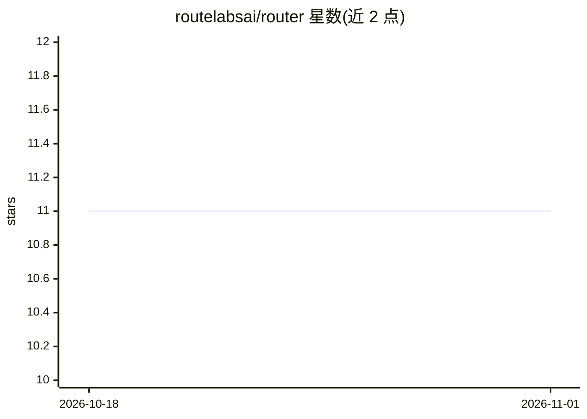

# routelabsai/router

⭐ 11 · Python · MIT · 推送 2026-10-20 · [GitHub](https://github.com/routelabsai/router) · [官网](https://pypi.org/project/routelabs-router/) · 组织维护

**本地优先的混合 LLM 路由网关：按隐私/策略选本地或云端**

面向 AI 应用与 agent 开发者的推理控制平面：在保留 OpenAI/Anthropic 兼容客户端接口的前提下，提供本地优先执行、云端回退、隐私感知路由与验证感知升级，并以 trace 展示每次请求留在本地、升级或回退的原因。本地运行时支持 Ollama 默认及 llama.cpp、LM Studio、vLLM 等 OpenAI 兼容服务器，云端通过可选的 API key 接入。提供 /v1/chat/completions、/v1/responses、/v1/messages、/v1/embeddings 端点、Python 客户端库、模型推荐命令与确定性策略基准。定位声明中自述为早期阶段（policy 与 provider 覆盖有限）。

## 筛选速览

| 维度 | 判定 | 备注 |
|---|---|---|
| AI 角色 | `ai-ecosystem` | LLM/agent 周边工具 |
| 许可风险 | `permissive` | MIT |
| 部署形态 | `library` | 以包/库形式分发 |
| 模型依赖 | local-ok | 支持本地模型 |
| 硬件要求 | — | 无带数字的原话,不猜 |
| 安装摩擦 | `low` | 无编译、无系统依赖或容器化 |
| 成熟度 | `idea` | |

## 能力要点

- OpenAI/Anthropic 兼容端点，迁移只需改 base_url
- 本地优先 + 隐私感知路由 + 验证感知升级与云端回退
- 请求级 trace 展示路由决策原因，/v1/route 规划端点
- 本地运行时可切换 Ollama/llama.cpp/LM Studio/vLLM，附本地模型推荐命令

## 适用场景

- 已有 OpenAI/Anthropic 客户端的应用加一层本地/云端路由
- 敏感数据请求强制本地执行的隐私合规场景
- agent 工作流中按任务复杂度自动升级或回退模型

## 场景标签

`模型网关` · 领域:Agent 开发

## 证据(README 行号)

> L8: `RouteLabs Router` is a privacy-first inference control plane for coding agents,
> L21: - OpenAI-compatible endpoints and an Anthropic-compatible Messages endpoint

## 星数曲线

2026-10-18 11 → 2026-11-01 11（+0）

---
*卡片 v1 · prompt 1.4 · 生成 2026-11-01 · 置信度 high · 依据 README sha `29c320135419` · [字段定义](../../DATASET.md)*
