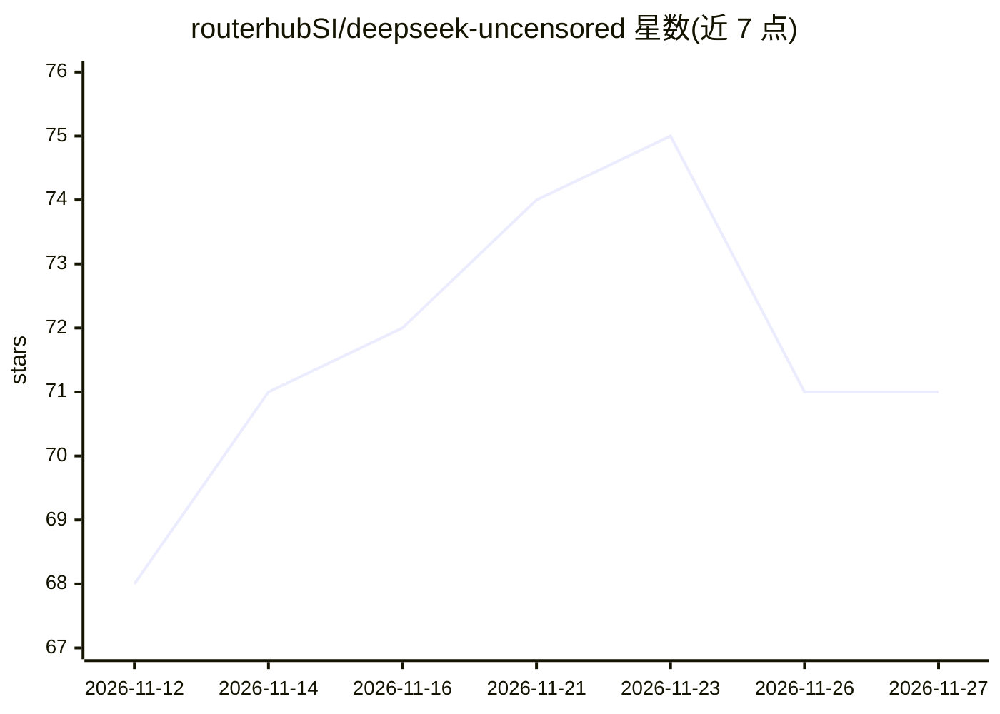

# routerhubSI/deepseek-uncensored

⭐ — · [GitHub]() · 组织维护

**RouterHub 维护的去审查 DeepSeek 模型变体清单与托管入口**

由 RouterHub 维护的 DeepSeek 无拒绝（uncensored/abliterated）模型编目：收录 V4.1 Flash 1017 固定检查点、V4 Pro、滚动变体等共 6 个托管 API 变体（单一 OpenAI/Anthropic 兼容端点，按 token 计价），并链接社区 GGUF 开源权重供 llama.cpp/Ollama/LM Studio 本地运行；另附红队提示词库（prompts.md）与文档集。仓库同时是 RouterHub 付费托管服务的入口，自述 'we run the repo'。变体间差异在权重层拒绝行为的移除方式与检查点固定策略（1017 为固定可复现构建）。

## 筛选速览

| 维度 | 判定 | 备注 |
|---|---|---|
| AI 角色 | `ai-knowledge` | 知识聚合/清单类 |
| 许可风险 | `permissive` | — |
| 部署形态 | `None` |  |
| 模型依赖 | local-ok | 支持本地模型 |
| 硬件要求 | — | 无带数字的原话,不猜 |
| 安装摩擦 | `low` | 无编译、无系统依赖或容器化 |
| 成熟度 | — | 结构信号不足 |

## 能力要点

- 收录 6 个 DeepSeek uncensored/abliterated 变体（含固定检查点 1017 与滚动构建）
- 社区 GGUF 开源权重可在 llama.cpp、Ollama、LM Studio 本地运行
- 附网络红队提示词库 prompts.md（拒绝探测、多轮探测、利用式提问）
- 单一 OpenAI/Anthropic 兼容端点托管全部变体，$0.15-$0.40/百万输入 token

## 适用场景

- 红队/渗透测试 agent 需要行为可复现的无拒绝模型
- 本地消费级硬件上运行 abliterated DeepSeek GGUF 构建
- 对比各 DeepSeek 变体的价格、上下文窗口与用途选型

## 场景标签

`网络安全` `精选清单` · 领域:学习与行业

## 证据(README 行号)

> L15: Every variant has its own page under `models/`:
> L51: **Hosted API variants** — all served through one OpenAI- and Anthropic-compatible endpoint:
> L96: RouterHub serves these variants — full disclosure, we run the repo. Setup guides cover the OpenAI, Anthropic and ag

## 星数曲线

2026-11-12 68 → 2026-11-27 71（+3）

---
*卡片 v1 · prompt 1.4 · 生成 2026-11-18 · 置信度 high · 依据 README sha `b813f5c7964f` · [字段定义](../../DATASET.md)*
