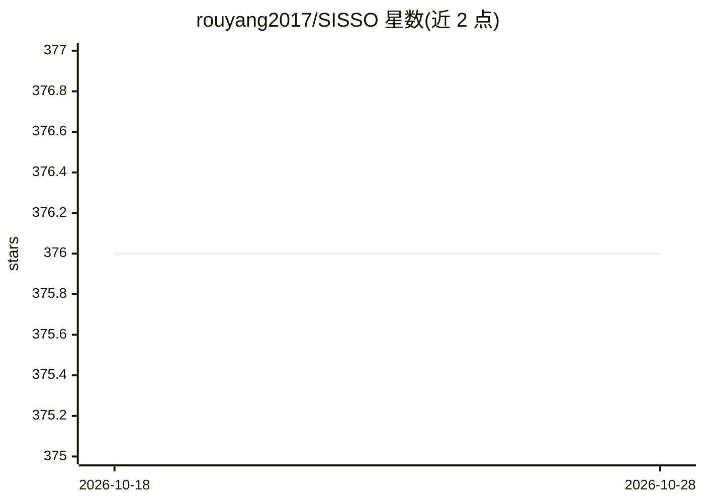

# rouyang2017/SISSO

⭐ 377 · Fortran · Apache-2.0 · 推送 2026-01-26 · [GitHub](https://github.com/rouyang2017/SISSO) · 个人维护

**材料科学场景的符号回归+压缩感知建模程序（Fortran/MPI）**

SISSO（Sure Independence Screening and Sparsifying Operator）是数据驱动建模程序，结合符号回归与压缩感知，从候选特征中筛选构造可解释模型；提供回归、分类、多任务学习（MT-SISSO）与变量选择辅助符号回归（VS-SISSO）。代码为 Fortran MPI 并行程序，需 mpiifort 等编译生成可执行文件，读取 SISSO.in 与 train.dat 输入，输出 SISSO.out、Models 与 SIS_subspaces。用户需查阅 SISSO_guide.pdf 掌握用法；输入模板随版本变化。

## 筛选速览

| 维度 | 判定 | 备注 |
|---|---|---|
| AI 角色 | `ai-native` | 本体是模型或模型工具 |
| 许可风险 | `permissive` | Apache-2.0 |
| 部署形态 | `None` |  |
| 模型依赖 | — | README 未给出锁定关系 |
| 硬件要求 | — | 无带数字的原话,不猜 |
| 安装摩擦 | `low` | 无编译、无系统依赖或容器化 |
| 成熟度 | — | 结构信号不足 |

## 能力要点

- 符号回归+压缩感知生成可解释模型
- 支持回归、分类与多任务学习（MT-SISSO）
- Fortran MPI 并行实现，可经 mpirun 在集群运行
- 提供变量选择辅助符号回归工具 VarSelect.py

## 适用场景

- 材料科学等领域从数据中筛选可解释描述符与模型
- 在高性能集群上并行运行符号回归任务
- 构造跨多个任务的共享描述符模型

## 场景标签

 · 领域:材料科学/机器学习

## 证据(README 行号)

> L8: - Regression & Classification
> L19: A Fortran mpi compiler is required to compile the SISSO parallel program. Below are two options for compiling the p

## 星数曲线

2026-10-18 376 → 2026-10-28 376（+0）

---
*卡片 v1 · prompt 1.4 · 生成 2026-10-21 · 置信度 high · 依据 README sha `b746f523c8d8` · [字段定义](../../DATASET.md)*
