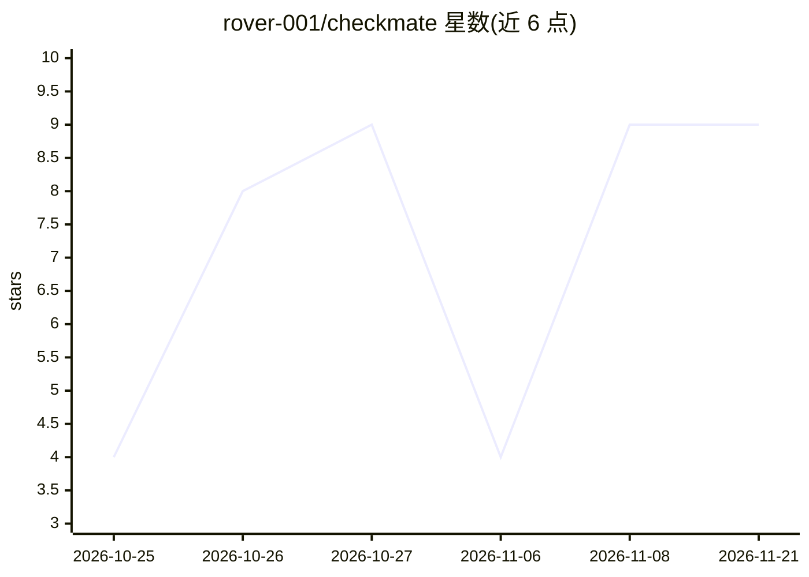

# rover-001/checkmate

⭐ 9 · JavaScript · MIT · 推送 2026-11-05 · [GitHub](https://github.com/rover-001/checkmate) · [官网](https://github.com/rover-001/checkmate) · 个人维护

**AI 编码 agent 的目标驱动规则模式：以最少步骤达成任务**

checkmate 为 AI 编码 agent 提供一套目标驱动的行为规则：先识别任务的达成条件，再以最短路径执行并最少输出 token，最后按真实运行行为与测试验证后才宣布完成。规则以单一源文件 rules/checkmate.md 维护，通过构建生成器分发到 Claude Code、Cursor、OpenCode、Codex 平台，在 Claude Code 中经 SessionStart 钩子自动注入上下文。提供 full/lite/ultra/off 四种模式、环境变量与配置文件优先级，以及 review/help/gain 三个伴随技能。

## 筛选速览

| 维度 | 判定 | 备注 |
|---|---|---|
| AI 角色 | `ai-ecosystem` | LLM/agent 周边工具 |
| 许可风险 | `permissive` | MIT |
| 部署形态 | `self-host` | docker 或自建部署 |
| 模型依赖 | — | README 未给出锁定关系 |
| 硬件要求 | — | 无带数字的原话,不猜 |
| 安装摩擦 | `low` | 无编译、无系统依赖或容器化 |
| 成熟度 | — | 结构信号不足 |

## 能力要点

- 单一规则源通过生成器分发到 4 个编码 agent 平台
- Claude Code 中经 SessionStart 钩子自动激活（<5ms，零依赖）
- full/lite/ultra/off 四种模式，可用环境变量与配置文件控制
- 附带 diff 审计（checkmate-review）与会话遥测分析（checkmate-gain）技能

## 适用场景

- 让编码 agent 减少对话性输出、直接完成任务
- 约束 agent 不随意引入抽象层、坚持根因修复
- 审计一次 diff 或 agent 回复中的绕路与范围蔓延
- 对比 checkmate 会话与基线会话的 token 消耗

## 场景标签

`提示工程` · 领域:Agent 开发

## 证据(README 行号)

> L9:  *Goal-driven mode for AI coding agents. Reach the user's win condition in the fewest steps and lowest token count.*
> L83: checkmate is designed as a single source of truth (`rules/checkmate.md`) with deterministic build generators for al
> L217: checkmate guarantees activation through a native **`SessionStart` hook** (`hooks/checkmate-instructions.js`):

## 星数曲线

2026-10-25 4 → 2026-11-21 9（+5）

---
*卡片 v1 · prompt 1.4 · 生成 2026-11-20 · 置信度 mid · 依据 README sha `a406af8a589c` · [字段定义](../../DATASET.md)*
