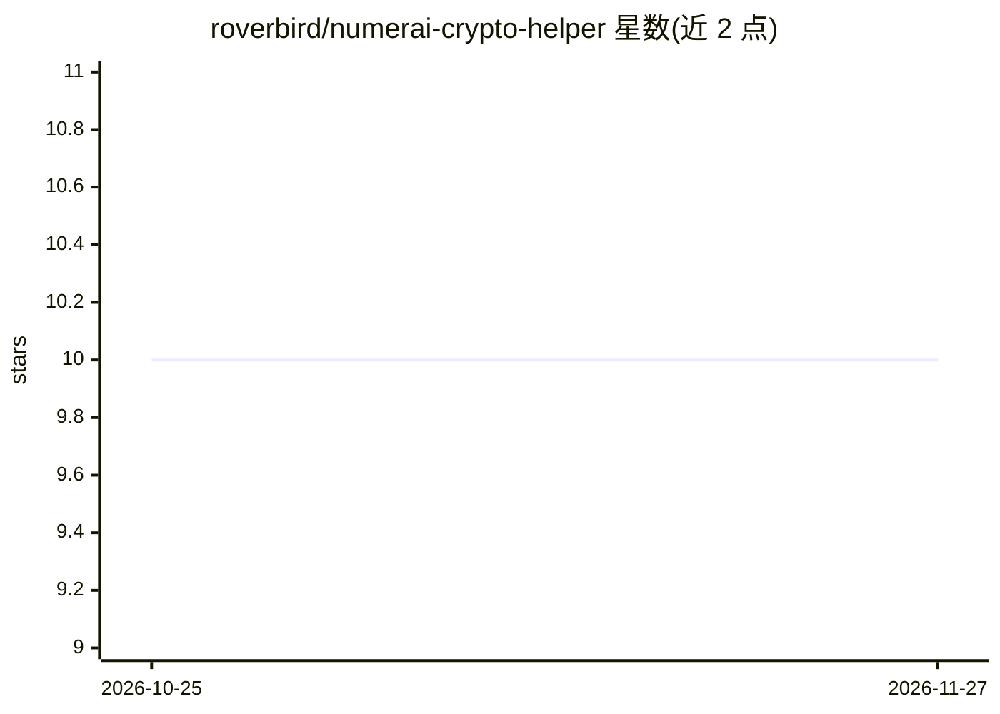

# roverbird/numerai-crypto-helper

⭐ 10 · Python · MIT · 推送 2026-01-08 · [GitHub](https://github.com/roverbird/numerai-crypto-helper) · 个人维护

**Numerai 加密信号竞赛的参与工具脚本集**

面向 Numerai Crypto Signals 竞赛参与者的非官方 Python 工具集合：提供查询竞赛轮次信息（round.py）、获取模型提交与 stake 详情（model.py）、自动化提交信号（submit.py）、爬取已结算轮次统计（scrap.py），以及 Yiedl 数据集的列提取与下载过滤脚本，用于准备训练数据并简化每日提交流程。依赖 numerapi/pandas/requests，MIT 许可，与 Numerai/Yiedl 无官方关联。

## 筛选速览

| 维度 | 判定 | 备注 |
|---|---|---|
| AI 角色 | `ai-ecosystem` | LLM/agent 周边工具 |
| 许可风险 | `permissive` | MIT |
| 部署形态 | `library` | 以包/库形式分发 |
| 模型依赖 | — | README 未给出锁定关系 |
| 硬件要求 | — | 无带数字的原话,不猜 |
| 安装摩擦 | `low` | 无编译、无系统依赖或容器化 |
| 成熟度 | — | 结构信号不足 |

## 能力要点

- submit.py 自动化向 crypto.numer.ai 提交加密信号
- yiedl-extractor.py 从 Parquet 历史数据提取指定列并按日期过滤导出 CSV
- scrap.py 以网页爬取方式批量下载已结算轮次数据
- round.py/model.py 查询轮次与模型提交状态

## 适用场景

- 准备参加 Numerai Crypto 竞赛时下载并整理 Yiedl 数据集
- 每天自动提交数百个币种的预测信号
- 批量下载自己模型的已结算轮次统计做分析

## 场景标签

`金融量化` · 领域:学习与行业

## 证据(README 行号)

> L43: This repository contains unofficial utilities for the Numerai Crypto Signals Contest. Intended to help users intera
> L7: The update _fundamentally changes the way the contest is approached_. Unlike the previous V1 setup, users no longer 

## 星数曲线

2026-10-25 10 → 2026-11-27 10（+0）

---
*卡片 v1 · prompt 1.4 · 生成 2026-11-19 · 置信度 mid · 依据 README sha `df6b5a857be7` · [字段定义](../../DATASET.md)*
