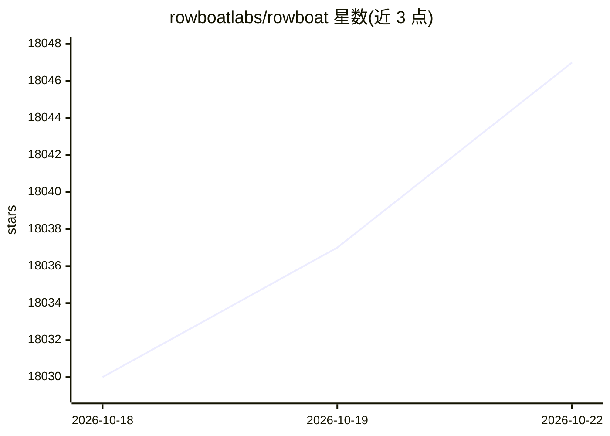

# rowboatlabs/rowboat

⭐ 18,050 · TypeScript · Apache-2.0 · 推送 2026-10-22 · [GitHub](https://github.com/rowboatlabs/rowboat) · [官网](https://www.rowboatlabs.com) · 组织维护

**本地优先的个人 AI 助手，带知识图谱与团队 Spaces 协作**

面向个人与团队的桌面端 AI 助手：将邮件、会议、Slack 与助手对话索引为 Obsidian 风格的双链知识图谱（Brain），并在此基础上提供邮件客户端、笔记、内置浏览器、会议记录、Code Mode（并行编码 agent）等工作界面。团队通过 Spaces（基于开源 Harbor 服务器）协作，各成员的助手在本机运行，仅以本人身份向房间发帖；个人数据以本地 Markdown 存储。支持 Ollama/LM Studio 本地模型或自带 API key。Mac/Windows/Linux 提供安装包，Harbor 可自托管。

## 筛选速览

| 维度 | 判定 | 备注 |
|---|---|---|
| AI 角色 | `ai-native` | 本体是模型或模型工具 |
| 许可风险 | `permissive` | Apache-2.0 |
| 部署形态 | `self-host` | docker 或自建部署 |
| 模型依赖 | local-ok | 支持本地模型 |
| 硬件要求 | — | 无带数字的原话,不猜 |
| 安装摩擦 | `low` | 无编译、无系统依赖或容器化 |
| 成熟度 | — | 结构信号不足 |

## 动量与使用信号

- 维护:`active` — 距上次 push 2.1 天,年发版 100,20 位贡献者
- 涨星:近 1 天 **+6**(自 20261016 起算)
- 平台:WINDOWS / LINUX · 协议:MCP / OLLAMA

## 能力要点

- 将邮件、会议、Slack、对话索引为本地双链知识图谱
- 基于事件或定时的后台 agent，可调用工具、搜索网页并经 Claude Code/Codex 写代码
- Spaces 多人协作：@rowboat 以用户身份在房间内干活，私有上下文不出本机
- 通过 MCP 连接外部工具，本地优先存储为纯 Markdown

## 适用场景

- 在本地积累长期工作知识，避免每次从零检索上下文
- 让 agent 按日程或邮件事件在后台自动处理工作
- 团队共享白板/文档，各自助手以本人名义参与协作
- 自托管 Spaces 服务器供组织使用

## 场景标签

`AI 助手` `知识图谱` · 领域:对话与助手

## 证据(README 行号)

> L6:  Open-source personal AI assistant with built-in docs, whiteboard and email. Works solo or with your team.
> L27: Rowboat indexes your work into a living knowledge graph and uses that to get work done on your machine. It includes
> L42: Rowboat indexes email, meetings, slack and assistant conversations into a living Obsidian-style backlinked knowledg

## 星数曲线

2026-10-18 18,030 → 2026-10-22 18,047（+17）

---
*卡片 v1 · prompt 1.4 · 生成 2026-10-18 · 置信度 high · 依据 README sha `b9ad51d7746e` · [字段定义](../../DATASET.md)*
