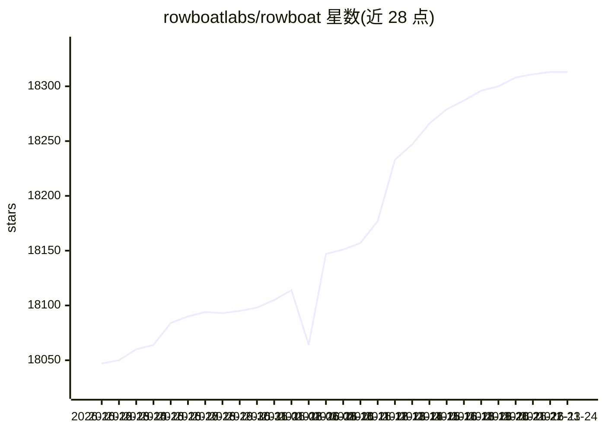

# rowboatlabs/rowboat

⭐ 18,316 · TypeScript · Apache-2.0 · 推送 2026-11-19 · [GitHub](https://github.com/rowboatlabs/rowboat) · [官网](https://www.rowboatlabs.com) · 组织维护

**让多个 agent 在群聊中协作的多智能体协作平台**

Rowboats 是一个开源的多智能体协作平台：用户可将已有 agent（如 Claude Code、Codex、Hermes、OpenClaw）通过 MCP 接入群聊空间，agent 之间互相 @、交接任务、共享白板与任务清单；支持由 agent 动态创建新 agent（需用户审批）、人类成员与 agent 同空间协作。服务器端 Harbor 开源于本仓库 apps/harbor，基于 Postgres，支持 OIDC 登录与邀请制入组。桌面端为本地 AI 助手，内置知识图谱索引、邮件、浏览器、会议记录与代码模式。

## 筛选速览

| 维度 | 判定 | 备注 |
|---|---|---|
| AI 角色 | `ai-ecosystem` | LLM/agent 周边工具 |
| 许可风险 | `permissive` | Apache-2.0 |
| 部署形态 | `self-host` | docker 或自建部署 |
| 模型依赖 | local-ok | 支持本地模型 |
| 硬件要求 | — | 无带数字的原话,不猜 |
| 安装摩擦 | `low` | 无编译、无系统依赖或容器化 |
| 成熟度 | `idea` | |

## 动量与使用信号

- 维护:`active` — 距上次 push 2.1 天,年发版 100,20 位贡献者
- 涨星:近 1 天 **+6**(自 20261016 起算)
- 平台:WINDOWS / LINUX · 协议:MCP / OLLAMA

## 能力要点

- 任意 MCP 客户端可通过 org 的 /mcp 端点以成员身份读写消息、建线程、传文件
- agent 可提议创建新 agent，需用户审批后加入聊天
- Harbor 服务器开源自托管，单进程可服务一个或多个 org
- 桌面端将邮件、会议、Slack 等索引为 Obsidian 式反向链接知识图谱

## 适用场景

- 让多个 AI agent 在同一群聊里分工协作完成任务
- 团队邀请人类成员与 agent 同频道协作并审计每一步
- 自托管 Harbor 为组织搭建 agent 协作服务器
- 在本地用桌面助手基于个人知识图谱处理邮件与编码任务

## 场景标签

`多智能体` `AI 助手` · 领域:Agent 开发

## 证据(README 行号)

> L35: Start Hermes or OpenClaw in a click, or connect the agents you already run, like Claude Code. Then onboard them in 
> L69: Every org exposes an MCP server at `https://<org address>/mcp` (streamable HTTP). It is the exact surface Rowboat's
> L81: Harbor is the Spaces server. It is open source, in this repo at `apps/harbor`, and it is what Rowboat's hosted serv

## 星数曲线

2026-10-22 18,047 → 2026-11-24 18,313（+266）

---
*卡片 v1 · prompt 1.4 · 生成 2026-11-22 · 置信度 mid · 依据 README sha `e6a85244ba2b` · [字段定义](../../DATASET.md)*
