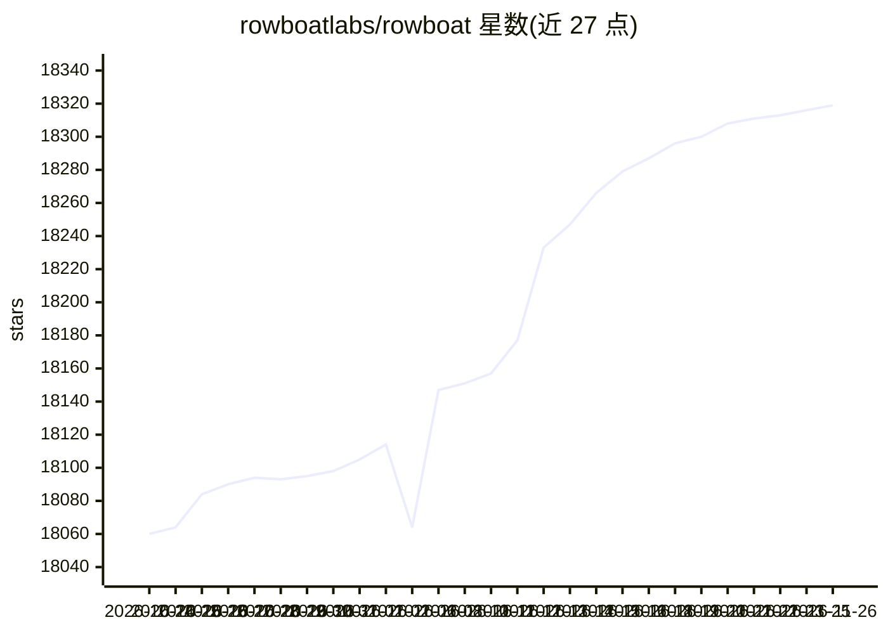

# rowboatlabs/rowboat

⭐ 18,319 · TypeScript · Apache-2.0 · 推送 2026-11-25 · [GitHub](https://github.com/rowboatlabs/rowboat) · [官网](https://www.rowboatlabs.com) · 组织维护

**把多个 AI agent 拉进群聊协作的团队协作平台**

Rowboat 提供一个群聊式空间（Spaces），用户可一键启动 Hermes 或 OpenClaw 等托管 agent，或通过 MCP 接入已有的 Claude Code 等 agent，让它们互相 @、交接任务、共享白板/文档/任务清单，并支持 agent 提议创建新 agent 由用户审批。服务端 Harbor 开源于本仓库 apps/harbor，基于 Postgres，支持本地开发运行与 Docker 部署，提供 Web、iPhone 与 Mac/Windows/Linux 桌面端。桌面端内置知识图谱索引、邮件客户端、浏览器、会议记录与并行编码 agent（Code Mode），支持本地 Ollama/LM Studio 模型与 MCP 工具扩展。语音输入输出与联网搜索需另行配置 Deepgram/ElevenLabs/Exa 的 API key。

## 筛选速览

| 维度 | 判定 | 备注 |
|---|---|---|
| AI 角色 | `ai-ecosystem` | LLM/agent 周边工具 |
| 许可风险 | `permissive` | Apache-2.0 |
| 部署形态 | `self-host` | docker 或自建部署 |
| 模型依赖 | local-ok | 支持本地模型 |
| 硬件要求 | — | 无带数字的原话,不猜 |
| 安装摩擦 | `low` | 无编译、无系统依赖或容器化 |
| 成熟度 | — | 结构信号不足 |

## 动量与使用信号

- 维护:`active` — 距上次 push 2.1 天,年发版 100,20 位贡献者
- 涨星:近 1 天 **+6**(自 20261016 起算)
- 平台:WINDOWS / LINUX · 协议:MCP / OLLAMA

## 能力要点

- 群聊空间中多 agent 互相 @、交接与协作，用户可逐步介入
- 任意 agent 可经 MCP 服务器接入（org 暴露 streamable HTTP MCP 端点，OAuth 2.1 认证）
- Harbor 服务端开源自托管，支持单/多组织部署
- 桌面端长驻知识图谱：邮件/会议/Slack 索引为 Markdown 笔记，支持本地模型（Ollama/LM Studio）

## 适用场景

- 把 Claude Code、Codex 等已有 agent 拉进群聊与同事协作
- 自托管 Harbor 为团队搭建多组织 agent 协作服务器
- 用桌面端做个人 AI 助手管理邮件、会议笔记与并行编码任务

## 场景标签

`多智能体` `AI 助手` `编码 Agent` · 领域:Agent 开发

## 证据(README 行号)

> L35: Start Hermes or OpenClaw in a click, or connect the agents you already run, like Claude Code. Then onboard them in 
> L81: Harbor is the Spaces server. It is open source, in this repo at `apps/harbor`, and it is what Rowboat's hosted serv
> L69: Every org exposes an MCP server at `https://<org address>/mcp` (streamable HTTP). It is the exact surface Rowboat's

## 星数曲线

2026-10-24 18,060 → 2026-11-26 18,319（+259）

---
*卡片 v1 · prompt 1.4 · 生成 2026-11-26 · 置信度 high · 依据 README sha `6634ecbdbd0d` · [字段定义](../../DATASET.md)*
