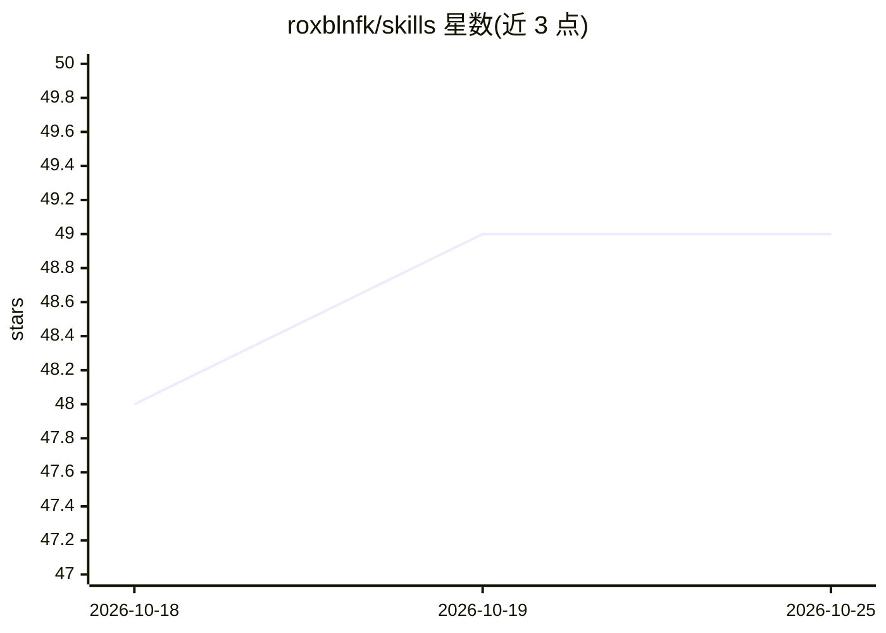

# roxblnfk/skills

⭐ 49 · PHP · BSD-3-Clause · 推送 2026-10-19 · [GitHub](https://github.com/roxblnfk/skills) · 个人维护

**以 Composer 依赖形式分发 AI Skills 的插件**

一个 PHP Composer 插件：从 Composer/vendor 包及任意 Git 仓库（GitHub/GitLab，经 skills:add 添加）下载 AI Skills（含 SKILL.md 的目录），并同步到项目本地目录（默认 .agents/skills/）。支持包内 extra.skills 声明与按 SKILL.md 自动发现、信任门控、外部 sources 与共享 bundle 去重；提供 skills:init/update/show/add 命令，composer install/update 后默认自动同步。面向使用 PHP Composer 的开发团队与 coding-agent 工具用户，另有无需 PHP 的独立二进制。

## 筛选速览

| 维度 | 判定 | 备注 |
|---|---|---|
| AI 角色 | `ai-ecosystem` | LLM/agent 周边工具 |
| 许可风险 | `permissive` | BSD-3-Clause |
| 部署形态 | `None` |  |
| 模型依赖 | — | README 未给出锁定关系 |
| 硬件要求 | — | 无带数字的原话,不猜 |
| 安装摩擦 | `low` | 无编译、无系统依赖或容器化 |
| 成熟度 | — | 结构信号不足 |

## 能力要点

- 从 vendor 包与 GitHub/GitLab 仓库同步 AI Skills 到项目本地目录
- 按 SKILL.md 自动发现，无需包显式声明
- 信任门控（trust 列表、vendor-sources 开关）控制第三方技能来源
- 提供独立二进制（linux/darwin/windows，无需 PHP）与全局安装方式

## 适用场景

- PHP 项目通过 Composer 依赖管理团队共享的 coding-agent 技能
- 把散落在多个 Git 仓库的 AI Skills 统一同步进项目
- 以 skills.json 提交配置，使团队技能设置可复现

## 场景标签

 · 领域:开发者工具/AI agent 基础设施

## 证据(README 行号)

> L8: A **Composer plugin** that downloads AI Skills from your Composer/vendor packages **and** from
> L12: An *AI Skill* is a directory containing a `SKILL.md` plus any auxiliary files (templates,

## 星数曲线

2026-10-18 48 → 2026-10-25 49（+1）

---
*卡片 v1 · prompt 1.4 · 生成 2026-10-24 · 置信度 high · 依据 README sha `d4d330a65e25` · [字段定义](../../DATASET.md)*
