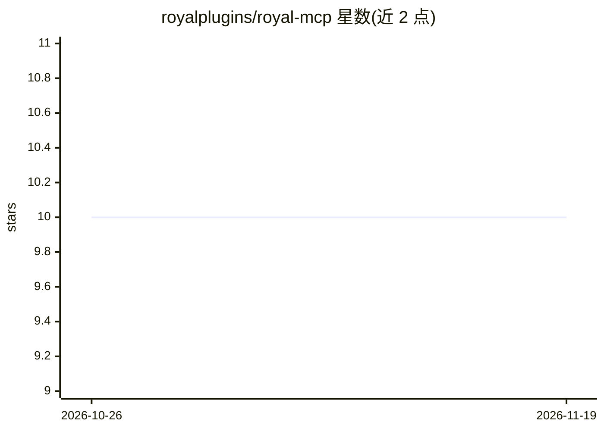

# royalplugins/royal-mcp

⭐ 10 · PHP · NOASSERTION · 推送 2026-11-17 · [GitHub](https://github.com/royalplugins/royal-mcp) · [官网](https://royalplugins.com/royal-mcp/) · 组织维护

**面向 WordPress 站长：把站点变成 MCP 服务器供 AI 代理读写管理**

开源 WordPress 插件，将站点转换为 Model Context Protocol 服务器，AI 应用连接后可读取和修改文章、页面、媒体、菜单、WooCommerce 商店、Elementor/Divi 页面、SEO、备份与安全设置。共 405 个工具（147 个核心常驻 + 258 个随 46 个插件加载的集成工具）。每次调用以 WordPress 用户身份执行并校验权限，写入活动日志；破坏性写入先存快照，72 小时内可撤销。支持只读/仅草稿模式、按连接分配访问级别、干运行预览；数据不经第三方中转。

## 筛选速览

| 维度 | 判定 | 备注 |
|---|---|---|
| AI 角色 | `ai-enhanced` | 去掉 AI 部分产品仍成立 |
| 许可风险 | `none` | NOASSERTION |
| 部署形态 | `None` |  |
| 模型依赖 | — | README 未给出锁定关系 |
| 硬件要求 | — | 无带数字的原话,不猜 |
| 安装摩擦 | `medium` | 含编译或系统依赖之一 |
| 成熟度 | — | 结构信号不足 |

## 能力要点

- 405 个 MCP 工具：147 核心工具 + 258 个跨 46 款插件的集成工具
- 破坏性写入存储快照，支持 72 小时撤销与活动日志审计
- 只读/仅草稿模式与按连接的访问级别控制
- 与 Elementor、WooCommerce 自带的 MCP 工具并行运行

## 适用场景

- 用自然语言让 AI 起草文章、上传配图并填写 SEO 元信息
- 批量查找并替换站点中过时的内容，每处改动可撤销
- 通过 AI 查询店铺库存并创建 WooCommerce 优惠券
- 让 AI 读取站点状态、错误日志并清理缓存排查性能问题

## 场景标签

`AI 助手` · 领域:对话与助手

## 证据(README 行号)

> L12: Royal MCP is an open-source WordPress plugin that turns your site into a Model Context Protocol server. Connect it 
> L3: **Run your WordPress site from Claude, ChatGPT or any AI app: write and edit content, manage your store, fix SEO and

## 星数曲线

2026-10-26 10 → 2026-11-19 10（+0）

---
*卡片 v1 · prompt 1.4 · 生成 2026-11-19 · 置信度 mid · 依据 README sha `659d1115b240` · [字段定义](../../DATASET.md)*
