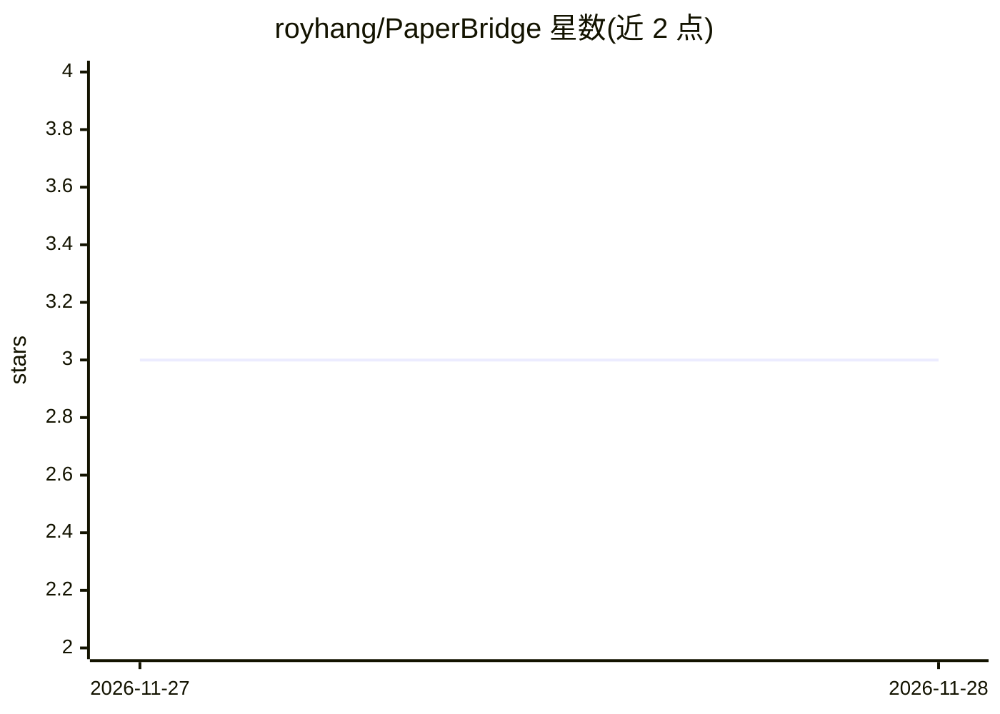

# royhang/PaperBridge

⭐ 3 · TypeScript · MIT · 推送 2026-11-27 · [GitHub](https://github.com/royhang/PaperBridge) · [官网](https://royhang.github.io/PaperBridge/) · 个人维护 · 中文 README

**面向研究生与科研人员的开源保版式双语论文阅读与文献库**

本地优先的学术文献工作台：保版式 PDF 双栏全文翻译（保留公式、图表、IEEE/ACM 排版，支持漏译自动重试与术语表）、Apple Pencil 原文/译文双层手写批注、类 Zotero 三栏文献库（嵌套分类、彩色标签、GB/T 7714 引用导出）、知网/arXiv 浏览器扩展一键入库，以及 Docker 自托管的端到端加密增量云同步。AI 论文问答附带全文上下文，长文档自动切换本地 BM25 页检索；划词翻译/解释。提供 Web、Windows 便携版与浏览器扩展。

## 筛选速览

| 维度 | 判定 | 备注 |
|---|---|---|
| AI 角色 | `ai-enhanced` | 去掉 AI 部分产品仍成立 |
| 许可风险 | `permissive` | MIT |
| 部署形态 | `desktop` | 安装包/桌面程序 |
| 模型依赖 | local-ok | 支持本地模型 |
| 硬件要求 | — | 无带数字的原话,不猜 |
| 安装摩擦 | `low` | 无编译、无系统依赖或容器化 |
| 成熟度 | — | 结构信号不足 |

## 能力要点

- 自研 TypeScript PDF 内容流解析的保版式双栏译文，含漏译重试与自动术语表
- AI 论文问答：全量上下文 + Claude prompt cache，100 页以上文档自动切换本地 BM25 检索
- 兼容 OpenAI 兼容接口、Anthropic、Gemini 及 DeepL/百度/有道等翻译服务
- Docker 一键自托管：增量同步 + PBKDF2/AES-256-GCM 端到端加密

## 适用场景

- 保持论文原排版的同时生成双语对照 PDF 阅读文献
- 在 iPad 上对原文与译文分别手写批注并多端同步
- 通过浏览器扩展从知网/arXiv 批量抓取文献入库并导出引用
- 自托管私有云同步文献库，保护 API Key 不上传明文

## 场景标签

`科研工具` `文档问答` `知识库管理` · 领域:知识与检索

## 证据(README 行号)

> L22: **PaperBridge 把这整条科研阅读链路合而为一，而且完全开源、自带 API 零订阅费、本地优先且支持 Docker 一键私有云同步：**
> L54: 5. **灵活省钱的 AI 精读问答与全接口兼容**
> L106: ## 支持的 API 服务

## 星数曲线

2026-11-27 3 → 2026-11-28 3（+0）

---
*卡片 v1 · prompt 1.4 · 生成 2026-11-27 · 置信度 high · 依据 README sha `714101de3014` · [字段定义](../../DATASET.md)*
