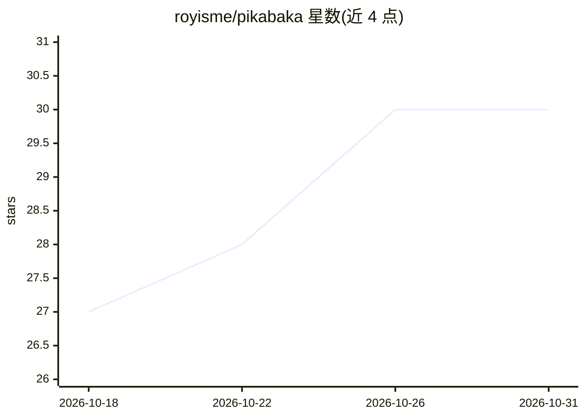

# royisme/pikabaka

⭐ 30 · TypeScript · AGPL-3.0 · 推送 2026-10-30 · [GitHub](https://github.com/royisme/pikabaka) · [官网](https://github.com/royisme/pikabaka) · 个人维护

**开源桌面 AI 面试助手与会议助手：实时转写+AI提示**

Electron 桌面应用，在用户本机运行：双通道捕获系统音频与麦克风，Rust 原生模块实现 500ms 内实时转写，由用户选择的 LLM（OpenAI/Claude/Gemini/Groq/Ollama 或任意 OpenAI 兼容端点）生成建议答案，支持截图送视觉模型推理、本地 RAG 会议记忆（sqlite-vec）与隐藏于屏幕共享的悬浮层。密钥存 OS 钥匙串，可配 Ollama 与本地 STT 实现全离线。支持 macOS 12+ 与 Windows 10/11，暂不支持 Linux。

## 筛选速览

| 维度 | 判定 | 备注 |
|---|---|---|
| AI 角色 | `ai-native` | 本体是模型或模型工具 |
| 许可风险 | `dual` | AGPL-3.0 |
| 部署形态 | `library` | 以包/库形式分发 |
| 模型依赖 | local-ok | 支持本地模型 |
| 硬件要求 | — | 无带数字的原话,不猜 |
| 安装摩擦 | `low` | 无编译、无系统依赖或容器化 |
| 成熟度 | — | 结构信号不足 |

## 能力要点

- Rust 原生音频模块（cpal+WebRTC VAD）实现 500ms 内双通道转写
- LLM/STT 提供商运行时切换，BYO API key，可全离线（Ollama+本地 STT）
- 截图送视觉模型推理与本地 RAG 会议记忆（sqlite-vec）
- 悬浮层可隐藏于屏幕共享，密钥存 OS 钥匙串

## 适用场景

- 面试前练习与彩排，获得实时的 AI 建议答案
- 销售与客服通话中实时获取话术、定价与产品信息
- 听课时实时转写、摘要并就刚听到的内容提问
- 通过 Ollama 与本地 STT 实现完全离线的隐私保护流程

## 场景标签

`AI 助手` `语音识别` · 领域:对话与助手

## 证据(README 行号)

> L3: **The open-source AI interview copilot & meeting assistant.**
> L13: Pika listens to your meetings, transcribes both sides of the conversation in under 500 ms, and quietly suggests ans
> L50: - **Any LLM, any STT** — switch providers at runtime: OpenAI, Anthropic Claude, Google Gemini, Groq, Ollama, or any

## 星数曲线

2026-10-18 27 → 2026-10-31 30（+3）

---
*卡片 v1 · prompt 1.4 · 生成 2026-10-26 · 置信度 mid · 依据 README sha `9b4236b29d55` · [字段定义](../../DATASET.md)*
