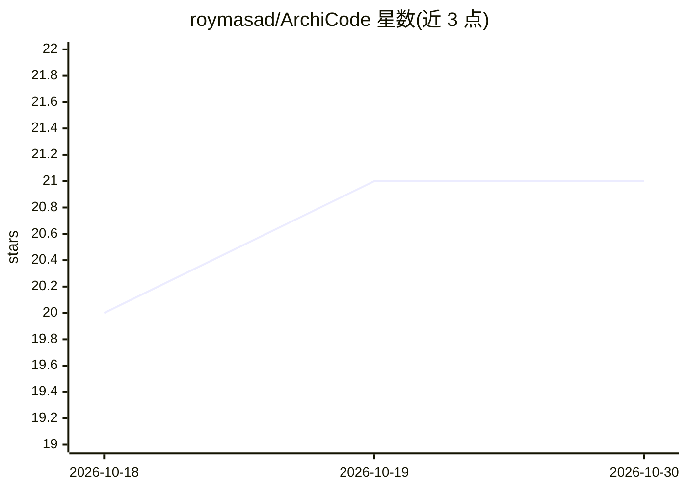

# roymasad/ArchiCode

⭐ 21 · TypeScript · AGPL-3.0 · 推送 2026-08-23 · [GitHub](https://github.com/roymasad/ArchiCode) · [官网](https://archicode.pixel-hat.com) · 个人维护

**图优先的本地 AI 编码工作台：架构图作为人与 agent 的共享真相**

基于 Electron 的本地软件工程工作台（harness），以持续同步的架构图为工程师与 AI agent 的共享上下文，覆盖调研、规划、实现、调试、验证与再同步循环。可调用本地编码 CLI（Codex、Claude Code、OpenCode 等）或 OpenAI/Anthropic 兼容 API 作为引擎，自身持有项目上下文、编排、可观测性与人工审查。支持实时语音调研（OpenAI Realtime）、2D/3D 架构图、知识图谱、代码-图再同步与分支预览。项目状态为活跃开发中。

## 筛选速览

| 维度 | 判定 | 备注 |
|---|---|---|
| AI 角色 | `ai-native` | 本体是模型或模型工具 |
| 许可风险 | `dual` | AGPL-3.0 |
| 部署形态 | `library` | 以包/库形式分发 |
| 模型依赖 | locked-api |  |
| 硬件要求 | — | 无带数字的原话,不猜 |
| 安装摩擦 | `low` | 无编译、无系统依赖或容器化 |
| 成熟度 | — | 结构信号不足 |

## 能力要点

- 架构图作为持久化共享上下文，连接计划、变更、测试与审查记录
- 可插拔引擎：本地编码 CLI 或 OpenAI/Anthropic 兼容 API
- OpenAI Realtime 实时语音调研与后台调研任务
- 代码与图的双向再同步、分支图预览、验收与策略检查

## 适用场景

- 在有架构图共享上下文的环境中调研、规划并实现代码变更
- 导入现有仓库生成有源码证据的架构视图与知识图
- 对 AI agent 的计划、diff、测试与运行历史做端到端审查

## 场景标签

`编码 Agent` `知识图谱` · 领域:编码与开发

## 证据(README 行号)

> L3: ArchiCode is a local, graph-native software engineering harness for investigating, researching, planning, building, 
> L22: This is not only a diagramming, analysis, or planning layer. It is an end-to-end alternative to chat-first coding h
> L42: - **Provider and tool choice** — use Codex, Claude Code, OpenCode, Google Antigravity, Grok Build, or Kimi Code loc

## 星数曲线

2026-10-18 20 → 2026-10-30 21（+1）

---
*卡片 v1 · prompt 1.4 · 生成 2026-10-28 · 置信度 high · 依据 README sha `8eeb9e92bbe6` · [字段定义](../../DATASET.md)*
