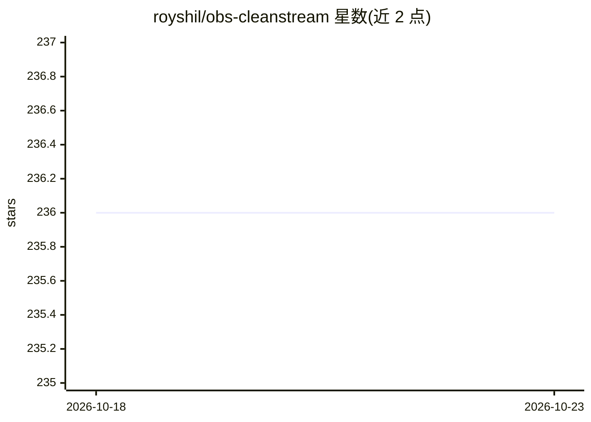

# royshil/obs-cleanstream

⭐ 236 · C++ · GPL-2.0 · 推送 2025-11-11 · [GitHub](https://github.com/royshil/obs-cleanstream) · [官网](https://obsproject.com/forum/resources/cleanstream-remove-uhs-ums-profanity-in-your-live-stream-or-recording-with-ai.1732/) · 个人维护

**OBS 插件：实时本地 AI 过滤直播音频中的脏话与语气词**

CleanStream 是一个 OBS Studio 音频滤波插件，在直播音频源上实时运行 Whisper（whisper.cpp）转录小段音频，对每段做出播放、静音或蜂鸣的决策，从而移除可配置的 unwanted 词（如脏话）及"uh""um"等语气词。处理在独立线程进行，内置自适应延迟以同步决策与回放（CUDA 系统可更快决策）。要求 OBS 28+，通过 GitHub releases 提供安装包，也提供 macOS/Windows/Linux 的源码构建流程（支持 CUDA/ROCm/Vulkan/OpenCL 加速）。

## 筛选速览

| 维度 | 判定 | 备注 |
|---|---|---|
| AI 角色 | `ai-native` | 本体是模型或模型工具 |
| 许可风险 | `viral` | GPL-2.0 |
| 部署形态 | `desktop` | 安装包/桌面程序 |
| 模型依赖 | — | README 未给出锁定关系 |
| 硬件要求 | — | 无带数字的原话,不猜 |
| 安装摩擦 | `medium` | 含编译或系统依赖之一 |
| 成熟度 | — | 结构信号不足 |

## 能力要点

- Whisper.cpp 实时转录并按段决策播放/蜂鸣/静音
- 可配置过滤词表（脏话与语气词）
- 内置自适应延迟机制同步决策与音频回放
- macOS/Windows/Linux 构建支持 CUDA/ROCm/Vulkan/OpenCL 加速

## 适用场景

- 直播时自动消音脏话或不雅词
- 去除口癖语气词让录音更干净
- 给任意 OBS 音频源加实时语音过滤

## 场景标签

`语音识别` · 领域:感知与多模态

## 证据(README 行号)

> L27: The filter is running Whisper in real-time to detect words in small chunks of the incoming audio. For each chunck i
> L46: It is using a neural network (OpenAI Whisper) to predict in real time the speech and remove the unwanted words.

## 星数曲线

2026-10-18 236 → 2026-10-23 236（+0）

---
*卡片 v1 · prompt 1.4 · 生成 2026-10-22 · 置信度 high · 依据 README sha `0d22f21b5b84` · [字段定义](../../DATASET.md)*
