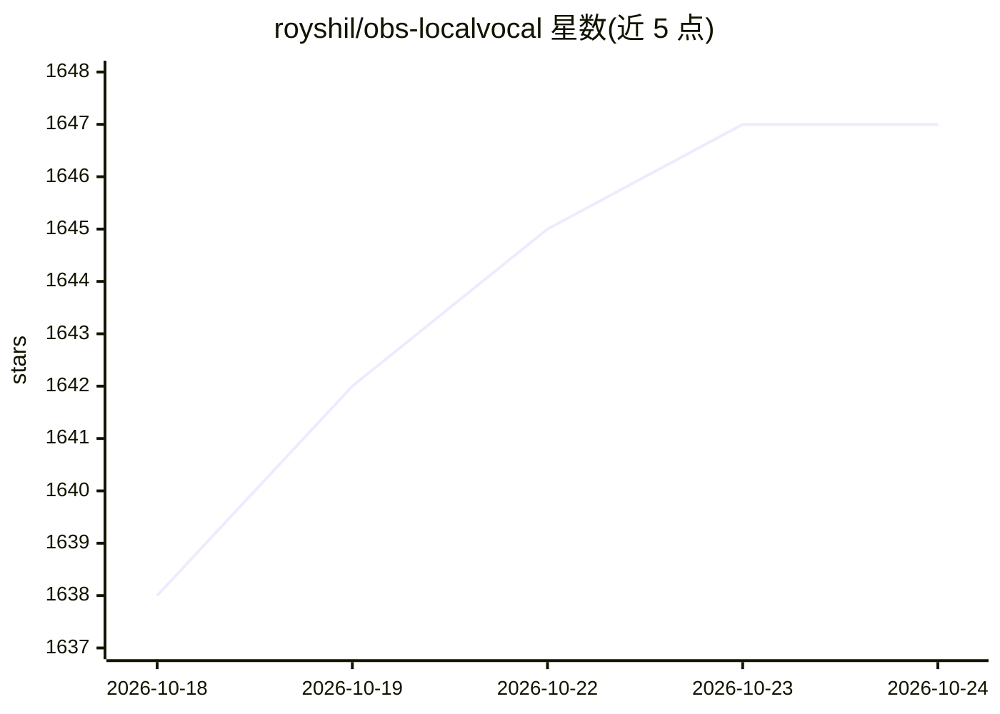

# royshil/obs-localvocal

⭐ 1,647 · C++ · GPL-2.0 · 推送 2026-10-15 · [GitHub](https://github.com/royshil/obs-localvocal) · [官网](https://obsproject.com/forum/resources/localvocal-live-stream-ai-assistant.1769/) · 个人维护

**OBS 本地语音转写与实时字幕/翻译插件**

OBS Studio 源/滤镜插件：在本地机器上用 OpenAI Whisper（经 Whisper.cpp 运行）对实时语音做转写，输出屏幕字幕、.txt/.srt 文件、与录制时间戳同步的字幕及 RTMP 推流字幕；翻译经 CTranslate2 完成，可搭配云端或本地 LLM。支持 100 种语言转写、自带 Tiny.en 模型并可下拉下载其他 GGML 模型。默认仅用 CPU（无需 GPU），可选 CUDA/ROCm/Vulkan/Metal 等加速后端动态加载。提供 Windows/Linux/macOS 预编译安装包，也可从源码构建。

## 筛选速览

| 维度 | 判定 | 备注 |
|---|---|---|
| AI 角色 | `ai-native` | 本体是模型或模型工具 |
| 许可风险 | `viral` | GPL-2.0 |
| 部署形态 | `desktop` | 安装包/桌面程序 |
| 模型依赖 | — | README 未给出锁定关系 |
| 硬件要求 | `cpu-ok` | |
| 安装摩擦 | `high` | 编译与系统依赖俱全 |
| 成熟度 | — | 结构信号不足 |

## 能力要点

- 实时语音转写（100 种语言），输出字幕文件与 RTMP 推流字幕
- 基于 Whisper.cpp 本地运行，默认 CPU-only，无云端与网络依赖
- CUDA、hipBLAS(ROCm)、Vulkan、Metal/CoreML、AVX/SSE 等多种加速后端动态加载
- 自带 Tiny.en 模型，支持任意外部 GGML Whisper 模型与 HuggingFace 微调模型

## 适用场景

- 直播时生成实时字幕并推送到 YouTube/Twitch
- 本地离线转写会议或录制音频为字幕文件
- 将语音实时翻译成其他语言的字幕

## 场景标签

`语音识别` · 领域:感知与多模态

## 证据(README 行号)

> L43: LocalVocal lets you transcribe, locally on your machine, speech into text and simultaneously translate to any langu
> L45: The plugin runs OpenAI's Whisper to process real-time speech and predict a transcription, utilizing Whisper.cpp fro
> L75: - Transcribe audio to text in real time in 100 languages

## 星数曲线

2026-10-18 1,638 → 2026-10-24 1,647（+9）

---
*卡片 v1 · prompt 1.4 · 生成 2026-10-21 · 置信度 high · 依据 README sha `ca283e671579` · [字段定义](../../DATASET.md)*
