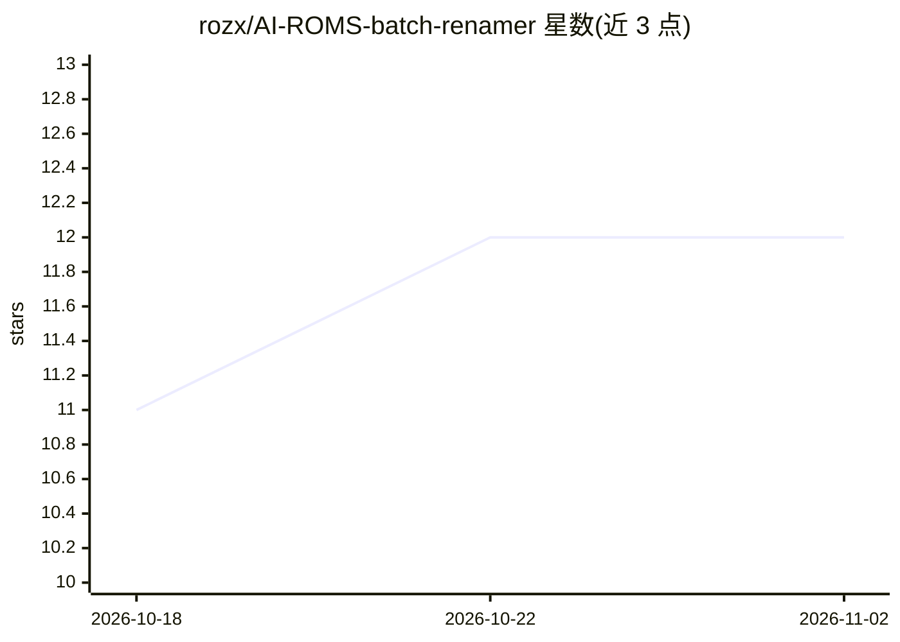

# rozx/AI-ROMS-batch-renamer

⭐ 12 · Python · MIT · 推送 2026-09-02 · [GitHub](https://github.com/rozx/AI-ROMS-batch-renamer) · [官网](https://github.com/rozx/AI-ROMS-batch-renamer) · 个人维护 · 中文 README

**ROM 批量重命名工具：本地数据库与 AI 辅助整理游戏文件名**

面向复古游戏玩家的 ROM 批量重命名工具，提供 PySide6 图形界面与 CLI 两种使用方式。核心机制：内置平台 CSV 数据库离线解析英文/中文标题（多步模糊匹配，无需 API 密钥）；可选接入任意 OpenAI 兼容 API 做 AI 补全，并通过 Tavily MCP 增加联网搜索。支持拼音首字母、平台别名归一化、ZIP 解压重命名、还原历史文件名与请求缓存。AI 为可选功能，仅用离线查找亦可完成重命名。

## 筛选速览

| 维度 | 判定 | 备注 |
|---|---|---|
| AI 角色 | `ai-enhanced` | 去掉 AI 部分产品仍成立 |
| 许可风险 | `permissive` | MIT |
| 部署形态 | `None` |  |
| 模型依赖 | — | README 未给出锁定关系 |
| 硬件要求 | — | 无带数字的原话,不猜 |
| 安装摩擦 | `low` | 无编译、无系统依赖或容器化 |
| 成熟度 | — | 结构信号不足 |

## 能力要点

- 内置 CSV 数据库离线解析英/中标题，无需 API 密钥
- 可选接入任意 OpenAI 兼容 API 批量查询标题
- PySide6 图形界面与 CLI 行为一致
- 还原功能可从历史缓存恢复原始文件名

## 适用场景

- 批量整理 GBA/NDS/PSX 等 ROM 库的文件命名
- 为 ROM 文件名补充中英文标题与拼音首字母
- 重命名后如需回退可一键还原原名

## 场景标签

 · 领域:游戏/文件管理工具

## 证据(README 行号)

> L9: 支持终端与图形界面，结合本地别名数据库与 AI 进行 ROM 批量重命名。
> L23: `--cn-lookup` 可从内置平台 CSV 数据库**离线**解析英文与中文标题，无需 API 密钥。采用多步模糊匹配（精确 → 模糊 → 别名），优先返回 USA / World 区版本，输出格式与 AI 模块完全兼容，可
> L35: |🤖 AI 补全 (`--ai`)|通过任意 OpenAI 兼容 API 批量查询标题|

## 星数曲线

2026-10-18 11 → 2026-11-02 12（+1）

---
*卡片 v1 · prompt 1.4 · 生成 2026-11-01 · 置信度 high · 依据 README sha `9feabca8ddd4` · [字段定义](../../DATASET.md)*
