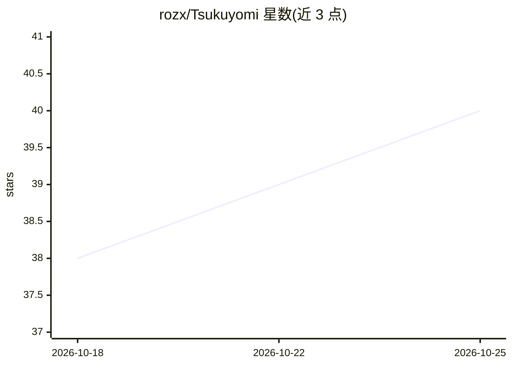

# rozx/Tsukuyomi

⭐ 40 · HTML · Apache-2.0 · 推送 2026-10-24 · [GitHub](https://github.com/rozx/Tsukuyomi) · [官网](https://tsukuyomi.rozx.moe/) · 个人维护 · 中文 README

**面向小说的 AI 导入、双语阅读与翻译工具**

Tsukuyomi 将小说导入、双语对照阅读、AI 翻译、润色和校对整合在一个工作台中，原文不限语言，可译为简体中文、繁體中文或 English，对日文网络小说与轻小说有专门支持（内置 syosetu/kakuyomu 等站点规则）。采用 BYOK 模式接入 OpenAI、Gemini 及兼容 OpenAI 协议的服务；通过术语表、角色设定、记忆库与章节语义索引为翻译提供上下文。提供网页版与 Electron 桌面版（macOS/Windows/Linux），跨设备经 GitHub Gist 同步；本地嵌入与数据默认存于浏览器 IndexedDB。

## 筛选速览

| 维度 | 判定 | 备注 |
|---|---|---|
| AI 角色 | `ai-native` | 本体是模型或模型工具 |
| 许可风险 | `permissive` | Apache-2.0 |
| 部署形态 | `None` |  |
| 模型依赖 | — | README 未给出锁定关系 |
| 硬件要求 | — | 无带数字的原话,不猜 |
| 安装摩擦 | `low` | 无编译、无系统依赖或容器化 |
| 成熟度 | — | 结构信号不足 |

## 能力要点

- 初翻/润色/校对全流程 AI 操作，多版本译文并存切换
- 术语表、角色设定、记忆库与章节语义索引构成上下文引擎
- BYOK 接入 OpenAI、Gemini 及 OpenAI 兼容协议服务
- 内置本地嵌入模型 bekko-embedding-v1-a25m，不上传文本到外部嵌入服务

## 适用场景

- 翻译并阅读日文网络小说与轻小说
- 维护术语与角色译名以保证长篇翻译一致性
- 在桌面、平板与手机间同步书库并双语阅读

## 场景标签

`AI 写作` · 领域:内容生成

## 证据(README 行号)

> L13: > 面向小说的 AI 导入、阅读与翻译工具：原文不限语言，可译为简体中文、繁體中文或 English；对日文网络小说与轻小说有专门支持。
> L15: **Tsukuyomi (月詠)** 将小说导入、双语阅读、翻译、润色和校对放在同一个工作台中。使用自己的 API Key 接入 OpenAI、Gemini 或兼容 OpenAI 协议的服务，通过术语、角色设定和记忆库为翻译提供上

## 星数曲线

2026-10-18 38 → 2026-10-25 40（+2）

---
*卡片 v1 · prompt 1.4 · 生成 2026-10-25 · 置信度 high · 依据 README sha `df65ea3121de` · [字段定义](../../DATASET.md)*
