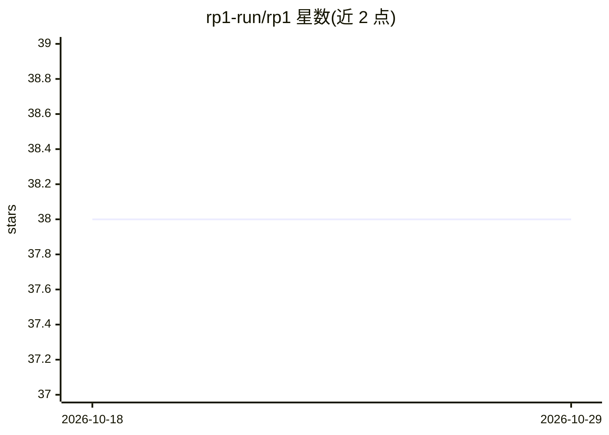

# rp1-run/rp1

⭐ 38 · TypeScript · Apache-2.0 · 推送 2026-10-25 · [GitHub](https://github.com/rp1-run/rp1) · [官网](https://rp1.run) · 组织维护

**为 AI 编程助手提供结构化命令与专业 agent 的工作流工具**

面向 Claude Code、OpenCode、Codex CLI 等 AI 编程助手的开发工作流层：通过宪法式提示词编码专家模式，宣称单次执行完成任务；提供 /knowledge-build 生成代码库知识库、子代理委托、假设验证等机制。以 CLI（brew/Scoop/安装脚本）分发，运行 rp1 install 向检测到的宿主工具注入插件，rp1 init 初始化项目。内置 /build、/pr-review、/code-investigate、/code-check 等斜杠命令。Apache 2.0 许可，OpenCode 与 Codex CLI 支持标注为实验性。

## 筛选速览

| 维度 | 判定 | 备注 |
|---|---|---|
| AI 角色 | `ai-ecosystem` | LLM/agent 周边工具 |
| 许可风险 | `permissive` | Apache-2.0 |
| 部署形态 | `None` |  |
| 模型依赖 | locked-api |  |
| 硬件要求 | — | 无带数字的原话,不猜 |
| 安装摩擦 | `low` | 无编译、无系统依赖或容器化 |
| 成熟度 | `idea` | |

## 能力要点

- knowledge-build 生成代码库知识库作为命令上下文
- 单次执行导向的结构化命令与专业子代理
- rp1 install 自动检测宿主工具并注入插件
- 平台支持 Claude Code（可用）、OpenCode/Codex CLI（实验性）

## 适用场景

- 让 AI 编程助手按结构化流程交付功能或审查 PR
- 生成代码库知识库使 AI 建议贴合项目架构
- 系统化排查 bug 并验证假设

## 场景标签

`编码 Agent` `代码审查` `提示工程` · 领域:Agent 开发

## 证据(README 行号)

> L13:  Professional development workflows for AI coding assistants.
> L15:  Works today with Claude Code . Experimental support for OpenCode and Codex CLI .

## 星数曲线

2026-10-18 38 → 2026-10-29 38（+0）

---
*卡片 v1 · prompt 1.4 · 生成 2026-10-25 · 置信度 high · 依据 README sha `e8743f722226` · [字段定义](../../DATASET.md)*
