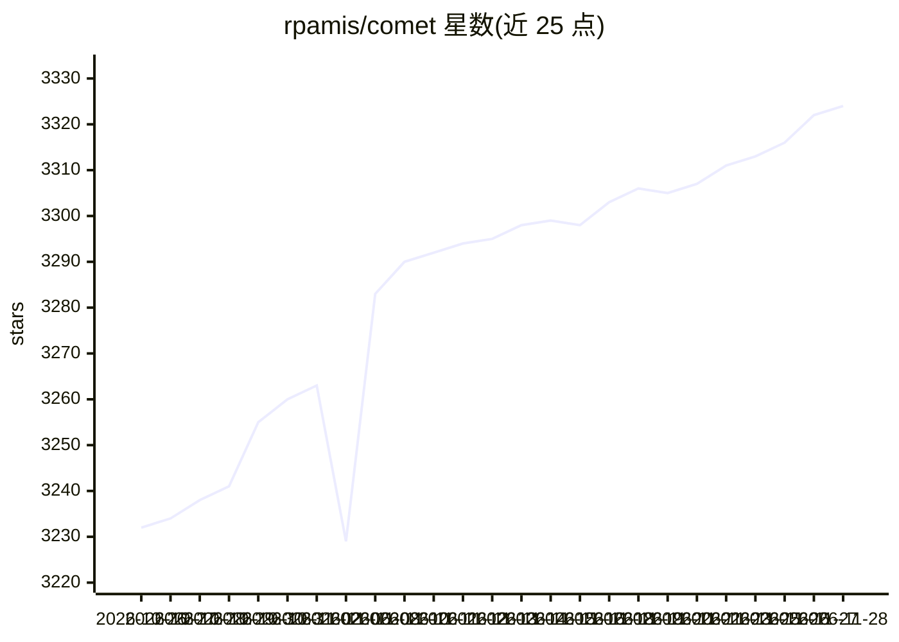

# rpamis/comet

⭐ 3,324 · JavaScript · MIT · 推送 2026-11-27 · [GitHub](https://github.com/rpamis/comet) · [官网](https://docs.comet.rpamis.com) · 组织维护 · 中文 README

**为 agent 提供可恢复长任务工作流与 Skill 平台的开发工具**

Comet 是面向 agent 的可恢复长任务工作流与 Skill 平台，提供两条独立的需求工作流：Native（面向强模型，由自身纯 Node.js 运行时驱动，无需 Bash/WSL）与 Classic（保留 OpenSpec + Superpowers 五阶段治理）。通过 Comet Any 与 JavaScript/TypeScript SDK 将既有 Skills 与工具组合为带用户确认、结果校验、中断恢复的工作流；Comet Eval 提供 Rubric、Pass@k、Pass^k 评分以评估 Skill；并含个人记忆、项目知识管理与三栏 Dashboard。跨平台支持 Windows/macOS/Linux，任务状态存于项目内以便恢复。

## 筛选速览

| 维度 | 判定 | 备注 |
|---|---|---|
| AI 角色 | `ai-ecosystem` | LLM/agent 周边工具 |
| 许可风险 | `permissive` | MIT |
| 部署形态 | `library` | 以包/库形式分发 |
| 模型依赖 | — | README 未给出锁定关系 |
| 硬件要求 | — | 无带数字的原话,不猜 |
| 安装摩擦 | `low` | 无编译、无系统依赖或容器化 |
| 成熟度 | — | 结构信号不足 |

## 能力要点

- Native/Classic 双工作流与状态机、阶段检查、可恢复归档
- Supervisor Change 按依赖 DAG 拆分需求，多 agent 在隔离 worktree 并行实现
- @rpamis/comet/runtime SDK 编排 Skill/工具步骤、审批与中断恢复
- Comet Eval 以 Rubric、Pass@k、Pass^k 评分并支持接入 LangSmith

## 适用场景

- 将需求从确认到验收归档跑成可恢复的开发工作流
- 把已有 Skills 组合为带确认与恢复的独立工作流应用
- 用 Pass@k/Pass^k 与 Rubric 评估和迭代自建 Skill
- 多 agent 并行交付含多个独立交付物的复杂需求

## 场景标签

`Agent 框架` `多智能体` `知识库管理` · 领域:Agent 开发

## 证据(README 行号)

> L57: **Comet is a resumable long-running task workflow and Skill platform for agents.**
> L99: - **Composable Skill Runtime SDK** — `@rpamis/comet/runtime` orchestrates Skill/tool steps, approval, outcome valid

## 星数曲线

2026-10-26 3,232 → 2026-11-28 3,324（+92）

---
*卡片 v1 · prompt 1.4 · 生成 2026-11-23 · 置信度 high · 依据 README sha `7460c9037bbd` · [字段定义](../../DATASET.md)*
