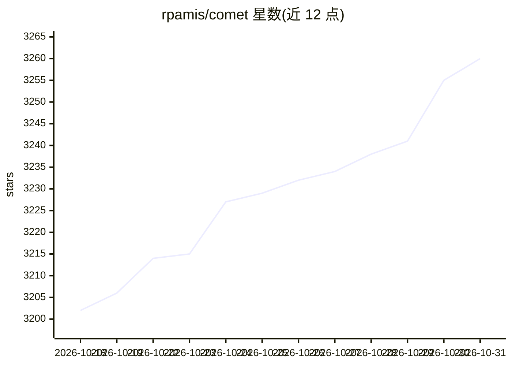

# rpamis/comet

⭐ 3,260 · JavaScript · MIT · 推送 2026-10-30 · [GitHub](https://github.com/rpamis/comet) · [官网](https://docs.comet.rpamis.com) · 个人维护 · 中文 README

**给编码 Agent 的可断点续跑任务工作流与 Skill 平台**

面向 AI 编码平台的任务工作流与 Skill 工具链：提供 Native（面向强模型，Agent 自主规划/实现/测试/审查）与 Classic（保留 OpenSpec + Superpowers 五阶段治理）两条独立工作流，均支持状态机、阶段守卫脚本与可恢复归档。复杂需求可拆分为依赖感知的子变更 DAG，由多个 Codex 会话或 Claude Code Agent Teams 在隔离 worktree 中并行实现后按序集成。Skill 部分支持用 /comet-any 组合任意 Skill 打包分发，comet eval 以 Rubric、Pass@k、Pass^k 及 LangSmith 集成做评估。纯 Node.js 运行时，跨 Windows/macOS/Linux，无需 Bash 或 WSL。

## 筛选速览

| 维度 | 判定 | 备注 |
|---|---|---|
| AI 角色 | `ai-ecosystem` | LLM/agent 周边工具 |
| 许可风险 | `permissive` | MIT |
| 部署形态 | `library` | 以包/库形式分发 |
| 模型依赖 | — | README 未给出锁定关系 |
| 硬件要求 | — | 无带数字的原话,不猜 |
| 安装摩擦 | `low` | 无编译、无系统依赖或容器化 |
| 成熟度 | — | 结构信号不足 |

## 能力要点

- Native 与 Classic 双工作流，均带状态机、阶段守卫与可恢复归档
- Supervisor Changes：子变更 DAG + 隔离 worktree 多 Agent 并行交付
- Skill 创作、/comet-any 组合打包分发与跨平台安装
- comet eval 提供 Rubric / Pass@k / Pass^k 评分与 LangSmith 集成

## 适用场景

- 让编码 Agent 按五阶段方法完成从需求到归档的长任务
- 把复杂需求拆给多个 Agent 并行实现再按依赖集成
- 创作、分发和用科学评分迭代自己的 Skill 包

## 场景标签

`编码 Agent` `多智能体` `Agent 框架` · 领域:Agent 开发

## 证据(README 行号)

> L64: **Comet is a resumable long-running task workflow and Skill platform for coding.**
> L76: > - **Skill creation, distribution, and evaluation**: Compose any Skills with `/comet-any` and package them for dis
> L94: - **Eval platform** — Comet assesses your skills using scientific Rubric, Pass@k, and Pass^k scoring, ensuring skil

## 星数曲线

2026-10-18 3,202 → 2026-10-31 3,260（+58）

---
*卡片 v1 · prompt 1.4 · 生成 2026-10-20 · 置信度 high · 依据 README sha `af9f0c5c36ec` · [字段定义](../../DATASET.md)*
