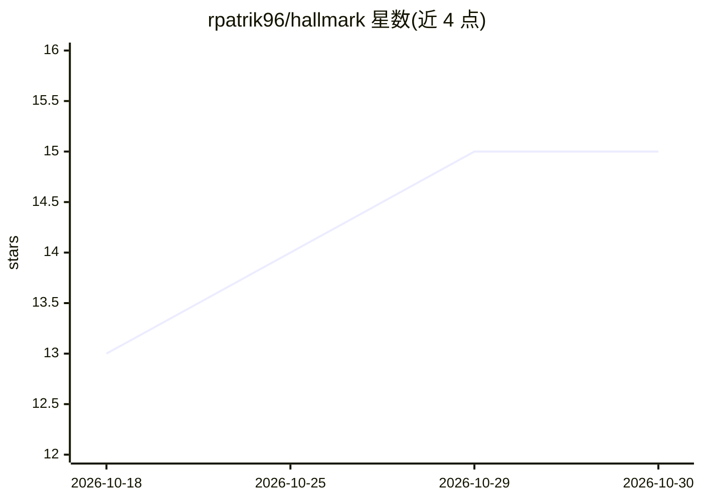

# rpatrik96/hallmark

⭐ 15 · Python · MIT · 推送 2026-10-22 · [GitHub](https://github.com/rpatrik96/hallmark) · [官网](https://rpatrik96.github.io/research-agora/benchmarks.html) · 个人维护

**引用幻觉检测基准：评测论文引用伪造检测工具**

面向引用幻觉检测工具的评测基准数据集：包含 2,526 条标注条目（826 条有效 + 1,246 条幻觉，另含 454 条隐藏分割），按 14 种幻觉类型、3 个难度层级组织，每条目含 6 个子测试（DOI 解析、标题匹配等）。提供 CLI 评估任意外部工具的 JSONL 预测文件，输出检测率、F1、AUROC、校准误差等指标，内置 19+ 基线变体（含 OpenAI/Anthropic/OpenRouter LLM 与级联方案）。基准设计借鉴 HumanEval/SWE-bench/ONEBench 的多子测试、时序防污染与可扩展样本池；README 详细讨论了标签边界（四种针对真实论文的模式）对排名稳定性的影响。MIT 许可。

## 筛选速览

| 维度 | 判定 | 备注 |
|---|---|---|
| AI 角色 | `ai-knowledge` | 知识聚合/清单类 |
| 许可风险 | `permissive` | MIT |
| 部署形态 | `library` | 以包/库形式分发 |
| 模型依赖 | — | README 未给出锁定关系 |
| 硬件要求 | — | 无带数字的原话,不猜 |
| 安装摩擦 | `low` | 无编译、无系统依赖或容器化 |
| 成熟度 | — | 结构信号不足 |

## 能力要点

- 14 种幻觉类型 × 3 难度层级，共 2,526 标注条目 + 454 隐藏条目
- 每条目 6 个子测试，指标含 DR/F1/tier-weighted F1/detect@k/ECE
- 支持 JSONL 预测文件评估任意外部工具，含 19+ 内置基线变体
- SQLite 缓存保证可复现运行，时序分析做污染检测

## 适用场景

- 评测自研引用核查工具的检测能力并生成排行榜
- 学术出版或审稿流程中比较引用幻觉检测方案
- 研究生成式引用错误（chimeric/near-miss 等）的检测难度分层

## 场景标签

`模型评测` · 领域:评测与运维

## 证据(README 行号)

> L3: **HALL**ucination bench**MARK**: A benchmark for evaluating citation hallucination detection tools.
> L25: - **2,526 annotated entries**: 826 valid + 1,246 hallucinated with ground truth across the public splits, plus a 45

## 星数曲线

2026-10-18 13 → 2026-10-30 15（+2）

---
*卡片 v1 · prompt 1.4 · 生成 2026-10-30 · 置信度 mid · 依据 README sha `e08a7d1111ed` · [字段定义](../../DATASET.md)*
