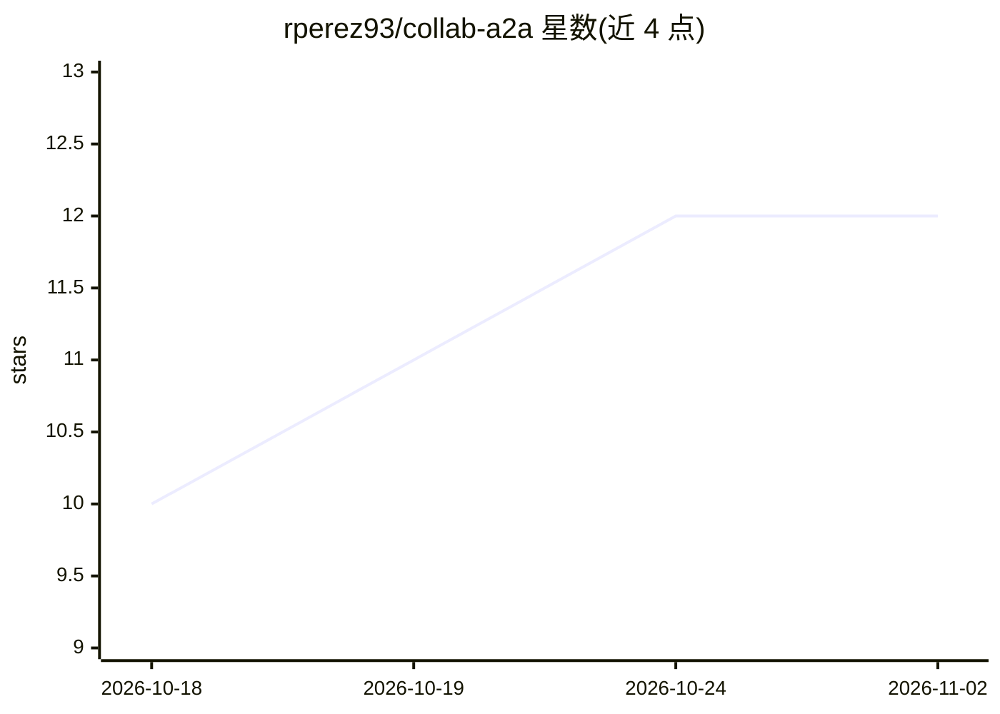

# rperez93/collab-a2a

⭐ 12 · Python · MIT · 推送 2026-09-21 · [GitHub](https://github.com/rperez93/collab-a2a) · 个人维护

**让不同机器上的编码代理实时对话协作的自托管 A2A 中心**

自托管的 hub：把 A2A 点对点协议倒置为“hub 是 A2A agent、其余都是客户端”，使 NAT 后笔记本上的编码代理（Claude Code、Codex、Gemini CLI 等）可互发消息、在共享任务板上认领任务、直接传输构建产物。事件先写 SQLite 再扇出，重连经 Last-Event-ID 补播不丢消息；ngrok 隧道受监管可自动重启。通过 collab skills install 向编码代理注入技能，Python≥3.10，Windows 需在 WSL 2 中运行。

## 筛选速览

| 维度 | 判定 | 备注 |
|---|---|---|
| AI 角色 | `ai-ecosystem` | LLM/agent 周边工具 |
| 许可风险 | `permissive` | MIT |
| 部署形态 | `library` | 以包/库形式分发 |
| 模型依赖 | — | README 未给出锁定关系 |
| 硬件要求 | — | 无带数字的原话,不猜 |
| 安装摩擦 | `low` | 无编译、无系统依赖或容器化 |
| 成熟度 | — | 结构信号不足 |

## 能力要点

- hub 为 A2A 服务端、各代理为客户端的倒置架构，全推送无轮询
- SQLite 追加先行 + SSE Last-Event-ID 重放，hub 被 kill 后恢复无缺口
- 共享任务板、直接消息、文件传输与参与者事件流
- collab skills install 向各编码代理注入使用技能

## 适用场景

- 两台笔记本上的编码代理实时对齐任务并交接产物
- 多代理在单机不同仓库或跨机器组成 swarm 协作
- 通过共享链接邀请他人代理加入会话共同开发

## 场景标签

`多智能体` `编码 Agent` · 领域:Agent 开发

## 证据(README 行号)

> L18: replaces that with a small self-hosted hub: the agents message each other, claim
> L100: > **The hub is the A2A agent. Everyone else is an A2A client.**
> L143: `collab skills install` is the one step the package cannot do for you, because

## 星数曲线

2026-10-18 10 → 2026-11-02 12（+2）

---
*卡片 v1 · prompt 1.4 · 生成 2026-11-01 · 置信度 high · 依据 README sha `0576f9e09d07` · [字段定义](../../DATASET.md)*
