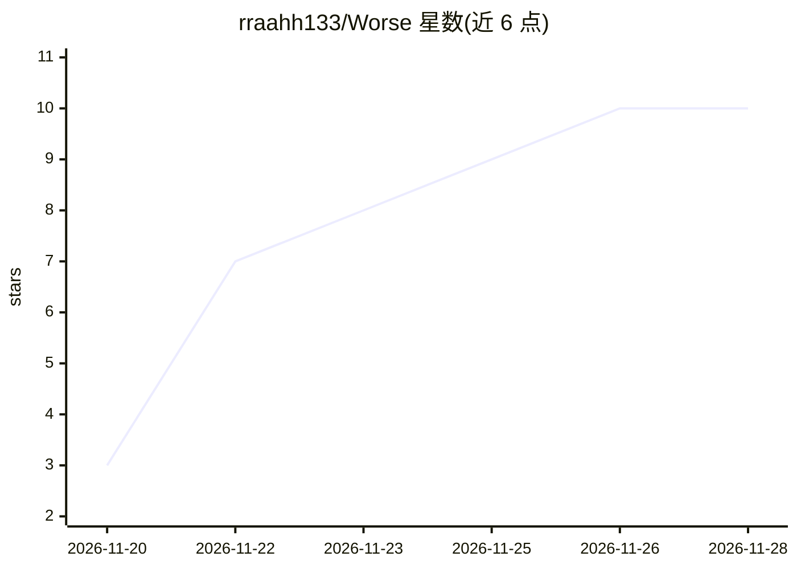

# rraahh133/Worse

⭐ 10 · Rust · Apache-2.0 · 推送 2026-11-24 · [GitHub](https://github.com/rraahh133/Worse) · [官网](https://rraahh133.github.io/Worse/) · 个人维护

**在单一桌面应用中并排运行多个 AI 编码 agent 并管理配额切换**

Rust 编写的原生桌面 GUI，通过 Agent Client Protocol (ACP) 驱动外部编码 agent CLI（Claude Code、Codex、Antigravity 等）及任意 OpenAI 兼容端点。核心机制：会话级 agent 选择、用量限额触发的自动 failover（保持对话记录连续）、本地 SQLite 统一存储对话记录、内置 MCP 服务器实现子 agent 委派。不内嵌 LLM 运行时。提供 Windows/macOS/Linux 安装包，界面用 Slint 构建，无 Electron/webview。

## 筛选速览

| 维度 | 判定 | 备注 |
|---|---|---|
| AI 角色 | `ai-ecosystem` | LLM/agent 周边工具 |
| 许可风险 | `permissive` | Apache-2.0 |
| 部署形态 | `desktop` | 安装包/桌面程序 |
| 模型依赖 | local-ok | 支持本地模型 |
| 硬件要求 | — | 无带数字的原话,不猜 |
| 安装摩擦 | `high` | 编译与系统依赖俱全 |
| 成熟度 | — | 结构信号不足 |

## 能力要点

- 用量限额时按可配置顺序自动切换到下一个 agent，对话记录保持完整
- 所有 agent 对话统一存入本地 SQLite：搜索、恢复、分叉、导入
- 内置 MCP 服务器支持子 agent 委派（每会话最多四个并发）
- 通过 ACP over stdio 驱动外部 agent CLI，不内嵌 LLM 运行时

## 适用场景

- 在多个编码 agent 之间切换工作并避免用量等待
- 把多个 API key 组成池子轮流使用，限额的 key 自动跳过
- 从手机远程查看和操控 agent 会话
- 让廉价 API 模型作为子 agent 处理常规编辑任务

## 场景标签

`编码 Agent` `多智能体` · 领域:Agent 开发

## 证据(README 行号)

> L78: - **Agents talk a standard protocol.** Harness does not embed an LLM runtime. It drives external
> L89: Harness does not replace the Claude Code, Codex or Antigravity CLIs: it runs them. What it adds is

## 星数曲线

2026-11-20 3 → 2026-11-28 10（+7）

---
*卡片 v1 · prompt 1.4 · 生成 2026-11-22 · 置信度 mid · 依据 README sha `3c50341bd9f5` · [字段定义](../../DATASET.md)*
