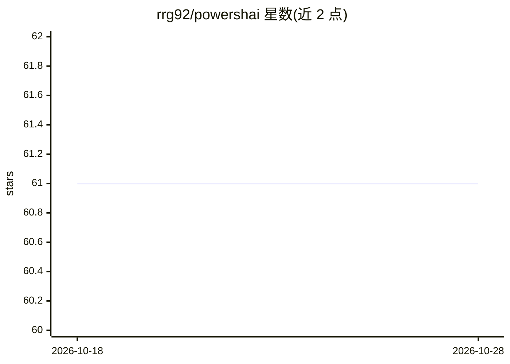

# rrg92/powershai

⭐ 61 · PowerShell · Apache-2.0 · 推送 2026-04-08 · [GitHub](https://github.com/rrg92/powershai) · [官网](https://powersh.ai) · 个人维护

**PowerShell 模块：在命令行中调用各类 AI 服务**

PowershAI 是一个 PowerShell 模块，让用户在 PowerShell 脚本与命令行环境中接入 AI 服务（README 主题标签列出 OpenAI、Gemini、Claude、Hugging Face、Groq、Maritalk、Gradio 等）。通过 PowerShell Gallery 的 Install-Module 命令安装，另提供无测试的 powershai-beta 预发布包用于提前获取变更。作者说明项目开发放缓但仍在维护，通过 issue 跟踪 AI 领域动态，README 提供包括中文在内的约 9 种语言链接。

## 筛选速览

| 维度 | 判定 | 备注 |
|---|---|---|
| AI 角色 | `ai-ecosystem` | LLM/agent 周边工具 |
| 许可风险 | `permissive` | Apache-2.0 |
| 部署形态 | `None` |  |
| 模型依赖 | — | README 未给出锁定关系 |
| 硬件要求 | — | 无带数字的原话,不猜 |
| 安装摩擦 | `low` | 无编译、无系统依赖或容器化 |
| 成熟度 | — | 结构信号不足 |

## 能力要点

- 以 PowerShell 模块形式提供，Install-Module 一键安装
- 主题标签显示覆盖 OpenAI/Gemini/Claude/Hugging Face/Groq/Maritalk/Gradio 等多种 AI 服务
- 提供 powershai-beta 预发布通道（无测试，作者提示谨慎使用）

## 适用场景

- 在 PowerShell 脚本或自动化任务中调用 AI 服务
- Windows 环境下用熟悉的命令行工具操作 AI 接口
- 提前通过 beta 包试用新变更

## 场景标签

`模型网关` · 领域:Agent 开发

## 证据(README 行号)

> L10: # PowershAI
> L23: Install-Module -Scope CurrentUser powershai

## 星数曲线

2026-10-18 61 → 2026-10-28 61（+0）

---
*卡片 v1 · prompt 1.4 · 生成 2026-10-24 · 置信度 mid · 依据 README sha `6a85b88f690f` · [字段定义](../../DATASET.md)*
