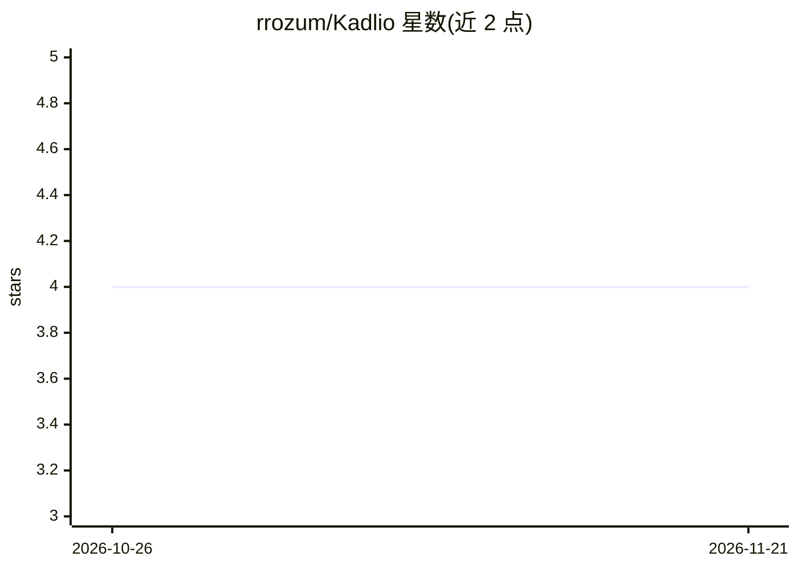

# rrozum/Kadlio

⭐ 4 · JavaScript · MIT · 推送 2026-10-26 · [GitHub](https://github.com/rrozum/Kadlio) · [官网](https://kadlio.pro) · 个人维护

**自托管 AI 演示文稿编辑器：从想法生成 HTML 幻灯片并导出 PPTX/PDF**

自托管的 HTML 演示文稿编辑器，每个幻灯片由 HTML 和 CSS 构成，提供可视化画布、图层与源码编辑。可通过聊天代理生成与修改幻灯片、管理主题、在幻灯片指定位置收集评论；代理通过 OpenAI 兼容 API、ACP 或 MCP 工具接入，用户自带 API 密钥，不使用 AI 也可手动编辑。支持 PPTX 导入，导出为 PDF、可编辑 PPTX 与离线 HTML。以 Docker 部署的单用户实例运行，当前为 beta 状态。

## 筛选速览

| 维度 | 判定 | 备注 |
|---|---|---|
| AI 角色 | `ai-enhanced` | 去掉 AI 部分产品仍成立 |
| 许可风险 | `permissive` | MIT |
| 部署形态 | `self-host` | docker 或自建部署 |
| 模型依赖 | — | README 未给出锁定关系 |
| 硬件要求 | — | 无带数字的原话,不猜 |
| 安装摩擦 | `low` | 无编译、无系统依赖或容器化 |
| 成熟度 | `idea` | |

## 能力要点

- 每张幻灯片为 HTML/CSS，支持画布拖拽与源码手动编辑，可不依赖 AI 使用
- AI 代理通过 MCP 工具读写幻灯片、主题与素材，支持 OpenAI 兼容 API 与 ACP
- 导出 PDF、可编辑 PPTX 与离线 HTML，支持 PPTX 导入
- Docker 卷持久化演示文稿、主题、素材与聊天记录，支持访客评论分享链接

## 适用场景

- 自托管搭建团队内部的演示文稿制作平台
- 通过对话描述报告内容由代理生成幻灯片初稿
- 基于 HTML/CSS 精细控制幻灯片样式并导出 PPTX/PDF

## 场景标签

 · 领域:办公/演示工具

## 证据(README 行号)

> L25: Каждый слайд — HTML и CSS. Агент может менять конкретный блок, а вы сразу видите результат. Можно двигать элементы 
> L27: Kadlio запускается на вашем компьютере или сервере. Вы выбираете ИИ-провайдера и подключаете свой API-ключ либо сер

## 星数曲线

2026-10-26 4 → 2026-11-21 4（+0）

---
*卡片 v1 · prompt 1.4 · 生成 2026-11-21 · 置信度 high · 依据 README sha `a1ed8df86854` · [字段定义](../../DATASET.md)*
