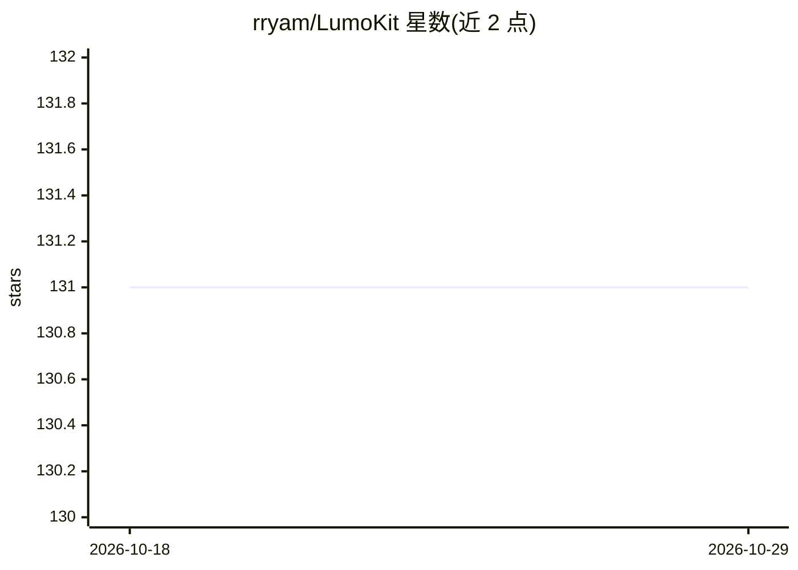

# rryam/LumoKit

⭐ 131 · Swift · MIT · 推送 2026-08-31 · [GitHub](https://github.com/rryam/LumoKit) · 个人维护 · 中文 README

**Swift 端上 RAG 管线库：文档解析→分块→向量索引→语义搜索**

面向 Apple 平台开发者的 Swift package，用 PicoDocs 解析 PDF/Markdown/HTML/文本，提供句子、段落、语义三种分块策略（可配置重叠与内容类型感知），再经 VecturaKit 完成向量存储与语义搜索，构成端到端 RAG 管线。嵌入器可插拔：内置默认外，支持 NLContextualEmbedder、OpenAI 兼容嵌入器与 MLXEmbedder 示例。基于 Swift 6.2+ 与 Swift 并发异步 API，要求 iOS 18.0+/macOS 15.0+，通过 Swift Package Manager 安装，MIT 许可。

## 筛选速览

| 维度 | 判定 | 备注 |
|---|---|---|
| AI 角色 | `ai-ecosystem` | LLM/agent 周边工具 |
| 许可风险 | `permissive` | MIT |
| 部署形态 | `None` |  |
| 模型依赖 | — | README 未给出锁定关系 |
| 硬件要求 | — | 无带数字的原话,不猜 |
| 安装摩擦 | `low` | 无编译、无系统依赖或容器化 |
| 成熟度 | — | 结构信号不足 |

## 能力要点

- PicoDocs 解析 PDF/Markdown/HTML/文本 + 三种分块策略（句子/段落/语义）
- VecturaKit 向量存储与语义搜索，搜索结果带来源元数据
- 嵌入器可插拔（NLContextual / OpenAI 兼容 / MLX 示例）
- Swift 并发异步 API，支持按需重置、删除分块与重索引

## 适用场景

- 在 iOS/macOS 应用内构建本地可搜索知识库
- 对文件夹内多种格式文档建立索引并语义检索
- 为问答功能按内容类型选择分块策略保留上下文

## 场景标签

`文档解析` `RAG` `语义搜索` · 领域:知识与检索

## 证据(README 行号)

> L3: LumoKit is a Swift package for building on-device **Retrieval-Augmented Generation (RAG)** workflows. It combines **
> L30: Source Document ──► PicoDocs parsing ──► LumoKit chunking ──► VecturaKit indexing ──► Semantic search

## 星数曲线

2026-10-18 131 → 2026-10-29 131（+0）

---
*卡片 v1 · prompt 1.4 · 生成 2026-10-22 · 置信度 high · 依据 README sha `dda67e5d6294` · [字段定义](../../DATASET.md)*
