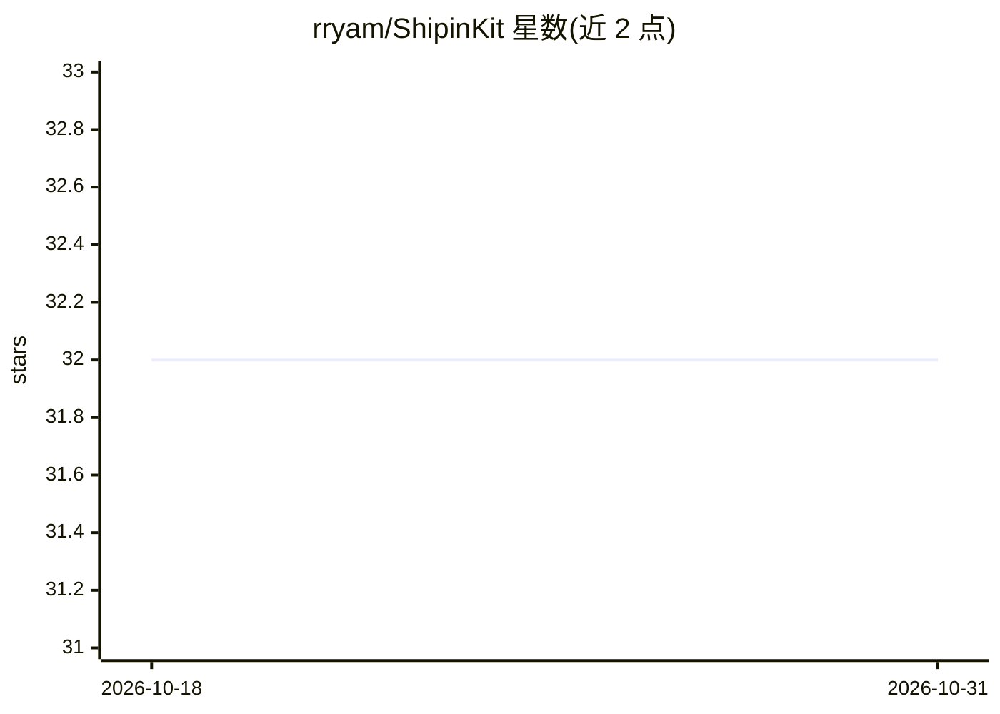

# rryam/ShipinKit

⭐ 32 · Swift · MIT · 推送 2026-07-31 · [GitHub](https://github.com/rryam/ShipinKit) · 个人维护

**面向 Swift 开发者的 Runway/Luma 视频生成 API 封装 SDK**

非官方 Swift SDK，为 Runway 与 Luma 的视频生成 API 提供类型化请求/响应封装：支持 Runway API 2024-11-06 的 Gen-4.5 与 Gen-4 Turbo 合同、Luma Ray 2 与 Ray 2 Flash，覆盖任务状态、失败回执、轮询超时与取消处理。凭据延迟解析且输出始终脱敏，支持注入自定义 ShipinTransport 做离线测试。要求 Swift 6.0+ 与 iOS 16+/macOS 14+ 等平台，通过 Swift Package Manager 安装；文档说明分发到客户端 App 的 API key 无法完全保密，生产环境应置于自有服务器。

## 筛选速览

| 维度 | 判定 | 备注 |
|---|---|---|
| AI 角色 | `ai-ecosystem` | LLM/agent 周边工具 |
| 许可风险 | `permissive` | MIT |
| 部署形态 | `None` |  |
| 模型依赖 | — | README 未给出锁定关系 |
| 硬件要求 | — | 无带数字的原话,不猜 |
| 安装摩擦 | `low` | 无编译、无系统依赖或容器化 |
| 成熟度 | — | 结构信号不足 |

## 能力要点

- Runway Gen-4.5/Gen-4 Turbo 与 Luma Ray 2/Ray 2 Flash 的类型化合同
- 凭据延迟解析且 String(describing:) 始终输出 <redacted>
- 可注入 ShipinTransport，离线 fixture 测试不调用真实服务
- 请求超时与轮询超时相互独立，支持取消与失败回执

## 适用场景

- 在 Swift/SwiftUI 应用中集成 Runway 或 Luma 的图生视频功能
- 为视频生成流程编写确定性单元测试而不调用真实 API
- 运行时动态切换 Runway/Luma 提供方并保持类型安全

## 场景标签

`视频生成` · 领域:内容生成

## 证据(README 行号)

> L3: ShipinKit is an unofficial Swift SDK for prototyping typed video-generation flows with the Runway and Luma APIs.
> L10: - Runway API version `2024-11-06` with Gen-4.5 and Gen-4 Turbo contracts
> L11: - Luma Ray 2 and Ray 2 Flash video-generation contracts

## 星数曲线

2026-10-18 32 → 2026-10-31 32（+0）

---
*卡片 v1 · prompt 1.4 · 生成 2026-10-25 · 置信度 high · 依据 README sha `44a227a398c5` · [字段定义](../../DATASET.md)*
