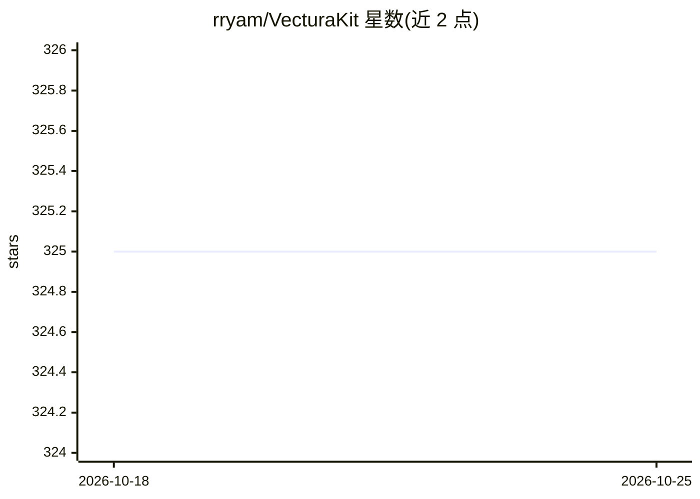

# rryam/VecturaKit

⭐ 325 · Swift · MIT · 推送 2026-08-31 · [GitHub](https://github.com/rryam/VecturaKit) · 个人维护

**Swift 设备端向量数据库，支持本地存储检索与混合搜索**

面向 Swift 开发者的本地向量数据库框架，提供文档的向量存储、批量索引、混合搜索（向量相似度 + BM25）与持久化存储。嵌入提供方可插拔：Apple NaturalLanguage（零外部依赖）、MLX GPU 加速（VecturaMLXKit）、swift-embeddings 模型（VecturaEmbeddingsKit）、以及 OpenAI 兼容 /v1/embeddings 端点（含 Ollama、LM Studio、vLLM 等本地服务器）。支持自定义存储后端与搜索引擎协议，提供 vectura-cli 与 vectura-oai-cli 命令行工具。平台要求 iOS 18/macOS 15 及以上，通过 Swift Package Manager 集成。

## 筛选速览

| 维度 | 判定 | 备注 |
|---|---|---|
| AI 角色 | `ai-ecosystem` | LLM/agent 周边工具 |
| 许可风险 | `permissive` | MIT |
| 部署形态 | `None` |  |
| 模型依赖 | local-ok | 支持本地模型 |
| 硬件要求 | — | 无带数字的原话,不猜 |
| 安装摩擦 | `low` | 无编译、无系统依赖或容器化 |
| 成熟度 | — | 结构信号不足 |

## 能力要点

- 可插拔嵌入提供方（NaturalLanguage/MLX/swift-embeddings/OpenAI 兼容）
- 向量相似度 + BM25 混合搜索，可自定义搜索引擎协议
- 自定义存储后端协议（SQLite/Core Data/云存储）
- 三种内存管理策略（自动/全内存/索引）适配千级至百万级文档

## 适用场景

- 在 iOS/macOS 应用中构建设备端 RAG 与语义搜索
- 无需外部服务、仅用 Apple 原生框架实现隐私优先的语义检索
- 通过 OpenAI 兼容端点接入 Ollama/vLLM 等本地嵌入服务器

## 场景标签

`向量数据库` · 领域:知识与检索

## 证据(README 行号)

> L3: VecturaKit is a Swift-based vector database designed for on-device apps through local vector storage and retrieval.
> L7: The framework offers `VecturaKit` as the core vector database with pluggable embedding providers. Use `OpenAICompati
> L289: VecturaKit supports OpenAI-compatible embedding APIs through `OpenAICompatibleEmbedder`. This is useful for local 

## 星数曲线

2026-10-18 325 → 2026-10-25 325（+0）

---
*卡片 v1 · prompt 1.4 · 生成 2026-10-21 · 置信度 high · 依据 README sha `b4a7dbaf1c7e` · [字段定义](../../DATASET.md)*
