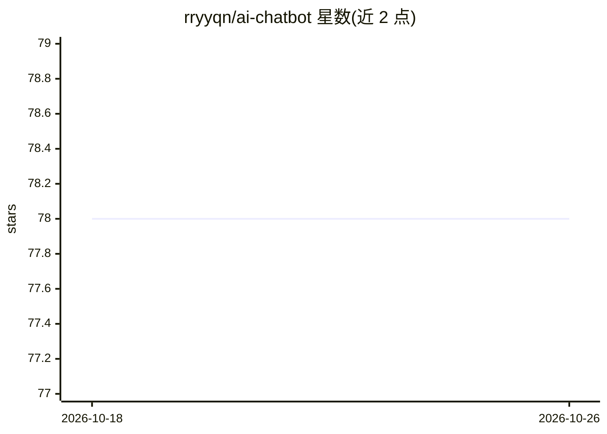

# rryyqn/ai-chatbot

⭐ 78 · TypeScript · MIT · 推送 2026-03-13 · [GitHub](https://github.com/rryyqn/ai-chatbot) · [官网](https://ai-chatbot-rryyqn.vercel.app) · 个人维护

**基于 Next.js 与 Gemini 的可定制 AI 客服聊天机器人模板**

面向需要快速搭建客服机器人的开发者的 Next.js 15 模板：通过 Vercel AI SDK 调用 Google Gemini 生成回答，支持流式输出与错误重试；内置 Arcjet 速率限制、机器人检测与攻击防护。提供 config.ts 集中配置机器人名称、欢迎语、系统提示词与限流参数，并支持在回复中渲染 choice/link 交互按钮。UI 基于 Tailwind CSS 定制，可部署到 Vercel 及其他支持 Next.js 的平台。MIT 许可。

## 筛选速览

| 维度 | 判定 | 备注 |
|---|---|---|
| AI 角色 | `ai-native` | 本体是模型或模型工具 |
| 许可风险 | `permissive` | MIT |
| 部署形态 | `library` | 以包/库形式分发 |
| 模型依赖 | — | README 未给出锁定关系 |
| 硬件要求 | — | 无带数字的原话,不猜 |
| 安装摩擦 | `low` | 无编译、无系统依赖或容器化 |
| 成熟度 | — | 结构信号不足 |

## 能力要点

- Vercel AI SDK + Google Gemini 的流式对话
- Arcjet 速率限制、机器人检测与防护
- config.ts 集中配置名称/欢迎语/系统提示词/限流
- choice/link 语法在回复中渲染交互按钮

## 适用场景

- 为网站快速搭建可定制的 AI 客服聊天机器人
- 需要限流与机器人防护的公开对话入口
- 在 Vercel 等平台部署 Next.js 对话应用

## 场景标签

`聊天机器人` · 领域:对话与助手

## 证据(README 行号)

> L3: A modern, customizable AI chatbot built with Next.js, Vercel AI SDK, and Google Gemini. Features include rate limiti
> L106: - **AI**: Vercel AI SDK with Google Gemini

## 星数曲线

2026-10-18 78 → 2026-10-26 78（+0）

---
*卡片 v1 · prompt 1.4 · 生成 2026-10-24 · 置信度 mid · 依据 README sha `ffd7f650b78c` · [字段定义](../../DATASET.md)*
