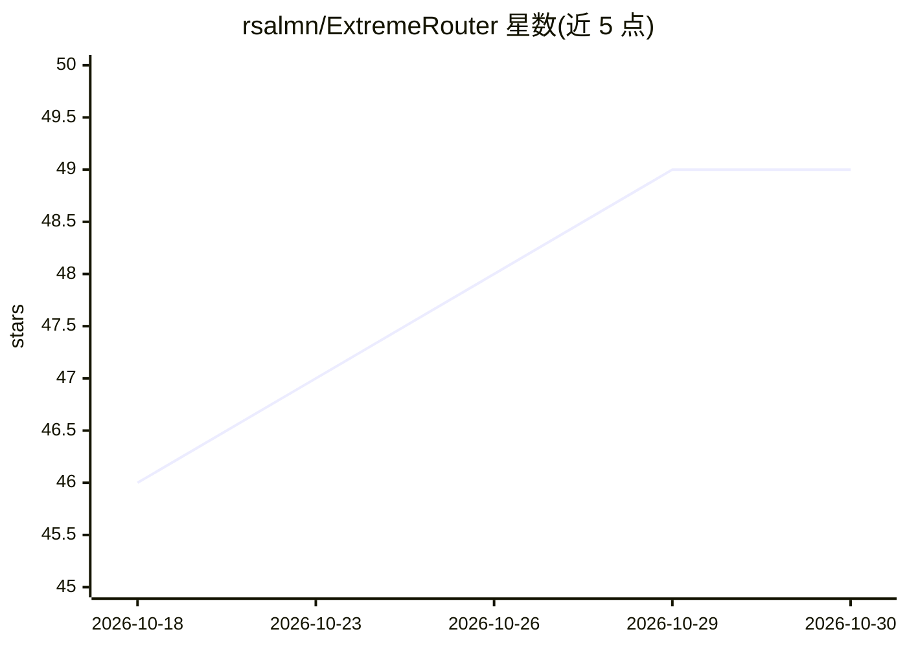

# rsalmn/ExtremeRouter

⭐ 49 · JavaScript · MIT · 推送 2026-09-27 · [GitHub](https://github.com/rsalmn/ExtremeRouter) · 个人维护 · 中文 README

**自托管 AI 网关：统一接入 304+ 提供商并路由编码工具流量**

自托管的 AI 网关控制平面：将 Claude Code、Cursor、Copilot、Codex 等 CLI 编码工具的请求经单一 /v1 端点路由到 304+ 提供商（API-key、OAuth、免费层、39 个网页 Cookie 提供商），提供 OpenAI/Claude/Gemini 等格式互译、6 种组合策略（fallback、round-robin、fusion、swarm、cascade、smart-routing）、配额跟踪、按提供商健康监控与熔断、token 压缩（RTK/Ponytail/Caveman）及用量分析仪表盘。以 npm 全局安装、源码运行或 Docker 三种方式部署，本地默认端口 20128。

## 筛选速览

| 维度 | 判定 | 备注 |
|---|---|---|
| AI 角色 | `ai-ecosystem` | LLM/agent 周边工具 |
| 许可风险 | `permissive` | MIT |
| 部署形态 | `self-host` | docker 或自建部署 |
| 模型依赖 | — | README 未给出锁定关系 |
| 硬件要求 | — | 无带数字的原话,不猜 |
| 安装摩擦 | `low` | 无编译、无系统依赖或容器化 |
| 成熟度 | — | 结构信号不足 |

## 能力要点

- 304+ 提供商接入单一 /v1 端点，含 39 个网页 Cookie 免费提供商
- 6 种组合策略：fallback / round-robin / fusion / swarm / cascade / smart-routing
- OpenAI ↔ Claude ↔ Gemini 等多格式互译，任意 CLI 工具对接任意提供商
- 按提供商健康监控、熔断状态机与多账户自动切换，配额实时跟踪

## 适用场景

- 让多个 AI 编码 CLI 工具共用一个网关端点，免于分别配置各家 key
- 配额耗尽或故障时在多个提供商与账户间自动切换，保持编码不中断
- 通过 RTK 压缩与提示注入减少输入输出 token 消耗
- 用仪表盘跟踪各提供商的 token 用量与费用估算

## 场景标签

`模型网关` · 领域:Agent 开发

## 证据(README 行号)

> L3: **A self-hosted AI gateway that routes traffic from your AI coding tools to 304+ providers with format translation, 
> L5: Connect Claude Code, Cursor, Antigravity, Copilot, Codex, Gemini, OpenCode, Cline, OpenClaw, and any OpenAI/Anthropi

## 星数曲线

2026-10-18 46 → 2026-10-30 49（+3）

---
*卡片 v1 · prompt 1.4 · 生成 2026-10-25 · 置信度 high · 依据 README sha `287f511aa255` · [字段定义](../../DATASET.md)*
