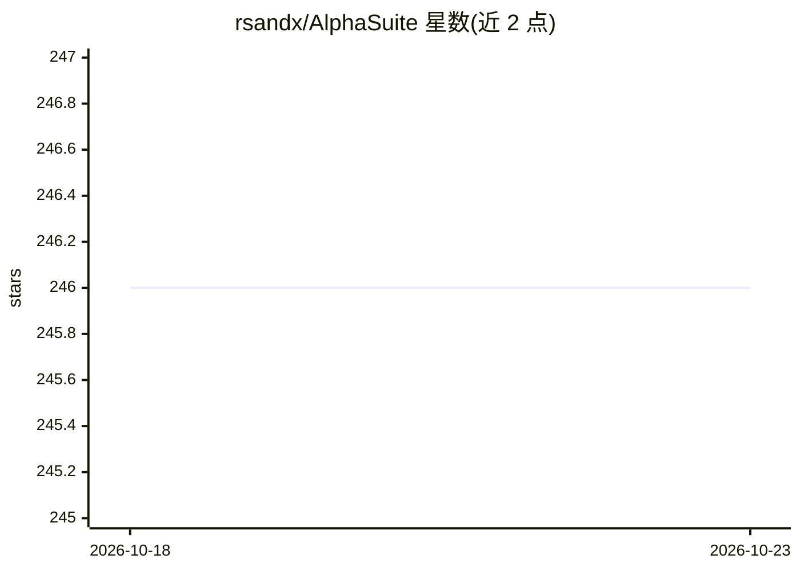

# rsandx/AlphaSuite

⭐ 246 · Python · MIT · 推送 2026-10-10 · [GitHub](https://github.com/rsandx/AlphaSuite) · [官网](https://alphasuite.aitransformer.net) · 个人维护

**面向交易者的开源量化分析与策略回测平台**

基于 Python/Streamlit 的量化交易分析平台：以 pybroker 为回测引擎，支持走查前推验证、贝叶斯参数优化、LightGBM 等 ML 模型集成，ML 输出直接作为交易信号；内置基于 ATR 与单笔风险的头寸规模与止损管理。提供可定制市场扫描器（含 20+ 预置扫描器）、无代码选股筛选 UI，数据经 yfinance/EODHD 拉取存入 PostgreSQL。LLM（Gemini/Ollama）用于生成个股报告与新闻简报。安装需 Python 3.9+、PostgreSQL 与 TA-Lib C 依赖，从源码运行。

## 筛选速览

| 维度 | 判定 | 备注 |
|---|---|---|
| AI 角色 | `ai-native` | 本体是模型或模型工具 |
| 许可风险 | `permissive` | MIT |
| 部署形态 | `library` | 以包/库形式分发 |
| 模型依赖 | local-ok | 支持本地模型 |
| 硬件要求 | — | 无带数字的原话,不猜 |
| 安装摩擦 | `low` | 无编译、无系统依赖或容器化 |
| 成熟度 | — | 结构信号不足 |

## 能力要点

- pybroker 回测引擎 + 走查前推分析与贝叶斯参数优化
- ATR/单笔风险驱动的头寸规模与止损管理
- ML-native 工作流：模型输出直接作为交易信号
- LLM 生成个股基本面/技术面报告与新闻风险简报（Gemini/Ollama 可选）

## 适用场景

- 构建、调优并在样本外验证 ML 交易策略
- 跨全球市场扫描交易机会并做无代码筛选
- 生成个股 AI 分析报告与市场新闻简报

## 场景标签

`金融量化` `数据分析` · 领域:效率与自动化

## 证据(README 行号)

> L10:  * **ML Integration**: Seamlessly integrate machine learning models (like LightGBM) into your strategies.
> L48: Unlike many platforms where machine learning is an optional add-on, AlphaSuite is **ML-native**. Its entire workflo
> L51: * **End-to-End ML-Centric Workflow**: Strategies are built around ML features, not just enhanced by them. The model

## 星数曲线

2026-10-18 246 → 2026-10-23 246（+0）

---
*卡片 v1 · prompt 1.4 · 生成 2026-10-22 · 置信度 low · 依据 README sha `fbed617cf3e7` · [字段定义](../../DATASET.md)*
