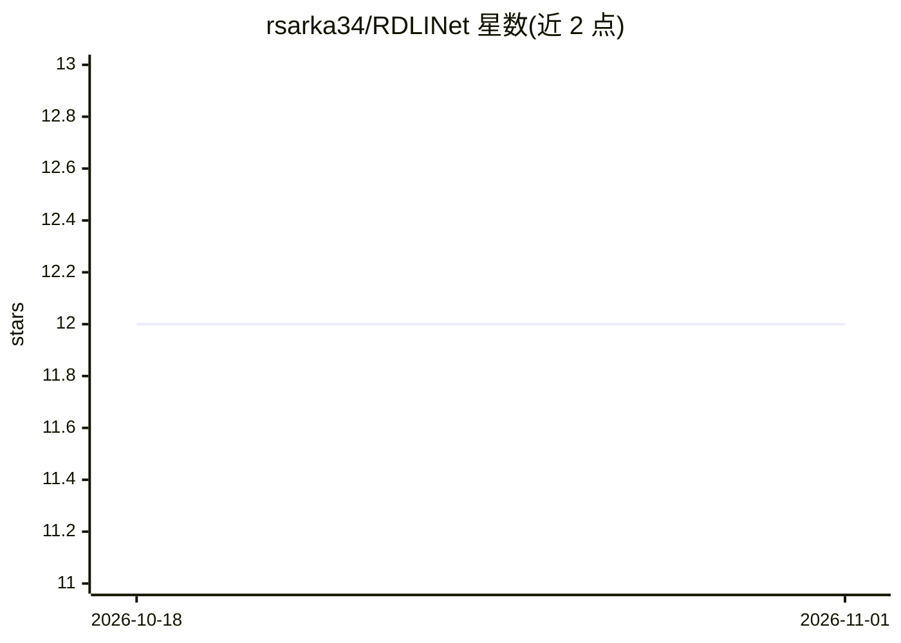

# rsarka34/RDLINet

⭐ 12 · Jupyter Notebook · MIT · 推送 2026-08-10 · [GitHub](https://github.com/rsarka34/RDLINet) · [官网](https://sites.google.com/view/arka-roy/home) · 个人维护

**轻量级 Inception 网络，用肺音信号分类呼吸系统疾病**

IEEE TIM 论文的官方代码仓库：提出 RDLINet 轻量级 Inception 网络框架，分三阶段处理肺音信号——预处理、mel 频谱图提取并转为三通道图像、再由网络分类为不同病理类别。论文报告在 ICBHI 等三个数据集上完成七类、六类及健康/哮喘二分类，准确率分别为 96.6%、99.6% 与 94.0%。面向复现论文实验的科研用户，README 提供数据集链接与引用信息，未见安装步骤细节。

## 筛选速览

| 维度 | 判定 | 备注 |
|---|---|---|
| AI 角色 | `ai-native` | 本体是模型或模型工具 |
| 许可风险 | `permissive` | MIT |
| 部署形态 | `None` |  |
| 模型依赖 | — | README 未给出锁定关系 |
| 硬件要求 | — | 无带数字的原话,不猜 |
| 安装摩擦 | `low` | 无编译、无系统依赖或容器化 |
| 成熟度 | — | 结构信号不足 |

## 能力要点

- 三阶段框架：预处理→mel 频谱图三通道化→Inception 网络分类
- 七类呼吸疾病分类实验（96.6%）
- 使用 ICBHI、KAUH、RespiratoryDatabase@TR 三个数据集评估

## 适用场景

- 复现 IEEE TIM 论文的肺音分类实验
- 基于轻量 CNN 开展呼吸疾病音频分类研究
- 在 ICBHI 等公开数据集上对比分类方法

## 场景标签

 · 领域:医学AI/音频信号分类

## 证据(README 行号)

> L3: **RDLINet: A Novel Lightweight Inception Network for Respiratory Disease Classification Using Lung Sounds**
> L14: Respiratory diseases are the world’s third leading cause of mortality. Early detection is critical in dealing with 

## 星数曲线

2026-10-18 12 → 2026-11-01 12（+0）

---
*卡片 v1 · prompt 1.4 · 生成 2026-11-01 · 置信度 mid · 依据 README sha `9fef043791ac` · [字段定义](../../DATASET.md)*
