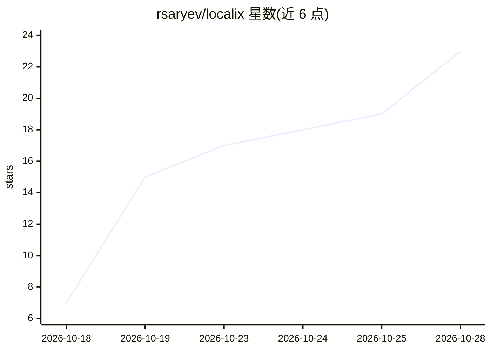

# rsaryev/localix

⭐ 22 · TypeScript · MIT · 推送 2026-10-28 · [GitHub](https://github.com/rsaryev/localix) · [官网](https://localix.ai) · 个人维护

**桌面 Agentic 开发环境：AI 代理团队协作于编辑器/终端/浏览器**

macOS 桌面应用（Tauri/Bun 技术栈），提供专业分工的 AI 代理团队共享一个对话、由代理驱动的浏览器、用小模型做应用内快速决策。兼容 Claude Code 插件格式（skills/命令/hooks/MCP/LSP，对照 Claude Code 2.1.310 检查），并支持以 /mini-app create 由代理生成自带界面与工具的迷你应用，可安装为独立 Mac 应用。模型可接任意 provider 或本地运行 GGUF 模型（如 Gemma），数据不出本机。macOS Apple silicon 提供签名安装包，其他平台需从源码运行。

## 筛选速览

| 维度 | 判定 | 备注 |
|---|---|---|
| AI 角色 | `ai-native` | 本体是模型或模型工具 |
| 许可风险 | `permissive` | MIT |
| 部署形态 | `desktop` | 安装包/桌面程序 |
| 模型依赖 | local-ok | 支持本地模型 |
| 硬件要求 | — | 无带数字的原话,不猜 |
| 安装摩擦 | `low` | 无编译、无系统依赖或容器化 |
| 成熟度 | — | 结构信号不足 |

## 能力要点

- 专业代理共享对话，请求自动路由到对应代理
- 兼容 Claude Code 插件格式（skills/hooks/MCP/LSP）
- /mini-app create 由代理构建迷你应用并自动检查（样式/类型/构建/测试）
- 本地运行 GGUF 模型，数据不出本机；默认开启语义搜索

## 适用场景

- 在一个桌面应用中用 AI 代理团队进行编码、浏览与测试
- 复用已有 Claude Code 插件与 ~/.claude 配置
- 让代理按自然语言描述生成并安装自己的小型应用
- 在本地跑模型做私密开发与语义搜索

## 场景标签

`多智能体` `编码 Agent` `浏览器自动化` · 领域:Agent 开发

## 证据(README 行号)

> L7:  A team of AI agents works with you in one desktop app: your editor, terminals and browser. Any model, or run one on
> L34:  Claude Code, Codex, Gemini CLI and more, linked to your chats.

## 星数曲线

2026-10-18 7 → 2026-10-28 23（+16）

---
*卡片 v1 · prompt 1.4 · 生成 2026-10-28 · 置信度 high · 依据 README sha `4e8057140f4f` · [字段定义](../../DATASET.md)*
