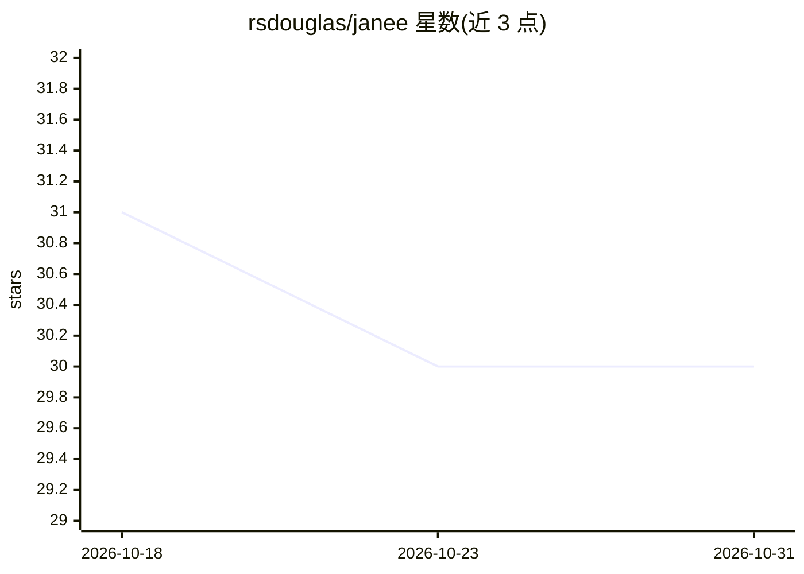

# rsdouglas/janee

⭐ 30 · TypeScript · MIT · 推送 2026-03-17 · [GitHub](https://github.com/rsdouglas/janee) · [官网](https://janee.io) · 个人维护

**面向 AI agent 的 MCP 密钥管理服务器：注入凭据、不暴露明文密钥**

Janee 是一个 MCP 服务器，用于为 AI agent 管理 API 密钥：密钥加密存储在本地 ~/.janee/，agent 通过 execute/exec 等 MCP 工具发起请求，Janee 代为注入凭据、执行请求策略（allow/deny 规则）、记录完整审计日志。支持 HTTP 代理与 CLI 工具注入两种模式，覆盖 Bearer、HMAC、OAuth 1.0a、AWS SigV4、GitHub App 等十种认证类型，并提供 Runner/Authority 架构支持容器内 agent。通过 npm 全局安装，兼容任意 MCP 客户端。

## 筛选速览

| 维度 | 判定 | 备注 |
|---|---|---|
| AI 角色 | `ai-ecosystem` | LLM/agent 周边工具 |
| 许可风险 | `permissive` | MIT |
| 部署形态 | `self-host` | docker 或自建部署 |
| 模型依赖 | — | README 未给出锁定关系 |
| 硬件要求 | — | 无带数字的原话,不猜 |
| 安装摩擦 | `low` | 无编译、无系统依赖或容器化 |
| 成熟度 | — | 结构信号不足 |

## 能力要点

- 密钥本地加密存储，agent 全程不接触明文凭据
- 按能力配置 allow/deny 请求策略与请求级审计日志
- exec 模式以环境变量注入凭据运行 CLI 工具，带命令白名单与运行器加固
- 支持 10 种认证类型（GitHub App、Twitter OAuth 1.0a、AWS SigV4 等）

## 适用场景

- 让 agent 调用 Stripe、GitHub 等外部 API 而不交出原始密钥
- 对 agent 的每次 API 请求做审计与按能力粒度的访问控制
- 容器化运行 agent 时通过 Runner/Authority 架构安全下发凭据

## 场景标签

`网络安全` · 领域:学习与行业

## 证据(README 行号)

> L40: Janee is an MCP server that manages API secrets for AI agents:
> L43: 2. **Run `janee serve`** — starts MCP server
> L266: Janee exposes three MCP tools:

## 星数曲线

2026-10-18 31 → 2026-10-31 30（-1）

---
*卡片 v1 · prompt 1.4 · 生成 2026-10-26 · 置信度 mid · 依据 README sha `87aad1a1b89d` · [字段定义](../../DATASET.md)*
