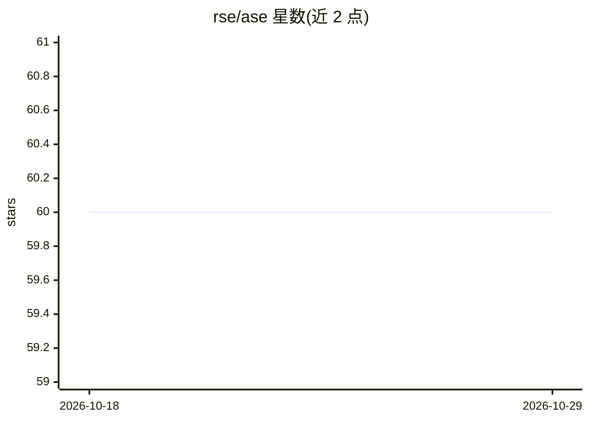

# rse/ase

⭐ 60 · TypeScript · Apache-2.0 · 推送 2026-10-27 · [GitHub](https://github.com/rse/ase) · [官网](https://ase.tools) · 个人维护

**面向开发者的 Agentic AI 编码工具箱：57 个技能扩展 Claude Code**

Agentic Software Engineering（ASE）是为软件开发者与架构师提供的 Claude Code 配套工具集，附带 57 个 agent 技能、agent hooks、子代理、MCP 服务与 CLI（含任务存储、任务看板与可选的自主 agent 舰队）。功能覆盖任务计划编辑/实现/集成、代码理解与词法/逻辑分析、文档压缩/润色/校对、变更日志、变更评审、语义化合并冲突解决、规范（SpecBook）管理、工作量估算等。次要支持 GitHub Copilot CLI 与 OpenAI Codex CLI（通过环境变量 ASE_TOOL 切换），强调 Human-in-the-Loop，自主 agent 为可选附加。

## 筛选速览

| 维度 | 判定 | 备注 |
|---|---|---|
| AI 角色 | `ai-ecosystem` | LLM/agent 周边工具 |
| 许可风险 | `permissive` | Apache-2.0 |
| 部署形态 | `library` | 以包/库形式分发 |
| 模型依赖 | locked-api |  |
| 硬件要求 | — | 无带数字的原话,不猜 |
| 安装摩擦 | `low` | 无编译、无系统依赖或容器化 |
| 成熟度 | — | 结构信号不足 |

## 能力要点

- 57 个 agent 技能 + hooks + 子代理 + MCP 服务 + CLI 任务看板
- 计划驱动任务流程：编辑/质询/实现/集成/分解/估算
- 语义化合并冲突解决与变更评审（approve/reject 裁决）
- 通过 ASE_TOOL 环境变量次要支持 Copilot CLI 与 Codex CLI

## 适用场景

- 在 Claude Code 中以结构化任务计划驱动代码实现与集成
- 让 agent 评审 Git 变更、拆分混合变更集、语义化解决合并冲突
- 管理、压缩与导出项目规范（SpecBook）并做一致性同步
- 以自主 agent 舰队无头执行从计划到集成的任务流水线

## 场景标签

`编码 Agent` `代码审查` · 领域:编码与开发

## 证据(README 行号)

> L16: opinionated Open Source companion
> L24: **ASE** ships with 57 agent skills, agent hooks, agent sub-agents, an
> L53: > **TOOL SUPPORT FOCUS**: The primary focus of **ASE** is on the Agentic AI Coding tool [*Claude

## 星数曲线

2026-10-18 60 → 2026-10-29 60（+0）

---
*卡片 v1 · prompt 1.4 · 生成 2026-10-24 · 置信度 high · 依据 README sha `923c6caab1b2` · [字段定义](../../DATASET.md)*
