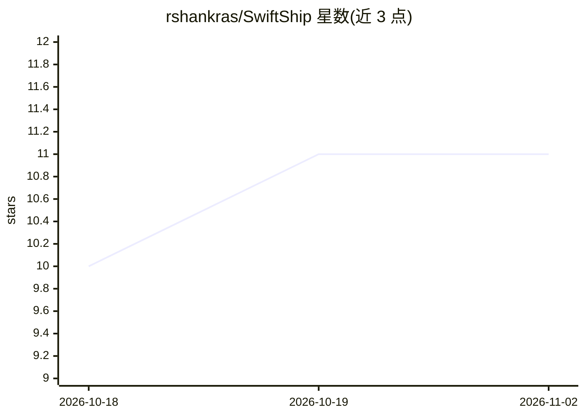

# rshankras/SwiftShip

⭐ 11 · Shell · 推送 2026-07-24 · [GitHub](https://github.com/rshankras/SwiftShip) · 个人维护

**基于 Claude Code 的 iOS/macOS 应用规格驱动开发命令集**

一组以 Markdown 指令文件形式安装进 Claude Code 的 /apple:* 斜杠命令、专家 agents 与技能库引用，覆盖从想法验证、规格定义、7 阶段路线图、阶段计划到构建测试与上架的完整流程。通过项目内 .planning/ 文件夹记录规格、路线图、决策与进度以保持跨会话上下文；可接入 App Store Connect 自动化（可选、预览确认后执行）。本身无需编译，需 Claude Code 与 Xcode/Swift 工具链，仅支持 macOS。

## 筛选速览

| 维度 | 判定 | 备注 |
|---|---|---|
| AI 角色 | `ai-ecosystem` | LLM/agent 周边工具 |
| 许可风险 | `none` | — |
| 部署形态 | `None` |  |
| 模型依赖 | locked-api |  |
| 硬件要求 | — | 无带数字的原话,不猜 |
| 安装摩擦 | `low` | 无编译、无系统依赖或容器化 |
| 成熟度 | — | 结构信号不足 |

## 能力要点

- 53 个 /apple:* 命令覆盖验证、规划、构建、测试、上架全生命周期
- 以 .planning/ 文件夹持久化规格、路线图、决策与进度
- 专家 agents 按需介入 SwiftUI、内购、iCloud、App Store 审核等领域
- 可选 App Store Connect 自动化，预览确认后推送元数据与 TestFlight 配置

## 适用场景

- 从零开始用 Claude Code 端到端开发并上架一个 iOS/macOS 应用
- 为现有应用生成阶段化的功能与修复计划
- 跨多个会话推进长期应用开发而不丢失决策上下文

## 场景标签

`编码 Agent` · 领域:编码与开发

## 证据(README 行号)

> L15: **SwiftShip is a project manager + a team of Apple specialists that sits on top of Claude Code.** It gives you:
> L21: > **Important:** SwiftShip is *not* an app and *not* a program you compile. It's a set of carefully‑written instruc
> L36: - **53 commands** covering the whole lifecycle: idea validation, planning, building, testing, App Store metadata, s

## 星数曲线

2026-10-18 10 → 2026-11-02 11（+1）

---
*卡片 v1 · prompt 1.4 · 生成 2026-11-01 · 置信度 high · 依据 README sha `3a83b4e091bb` · [字段定义](../../DATASET.md)*
