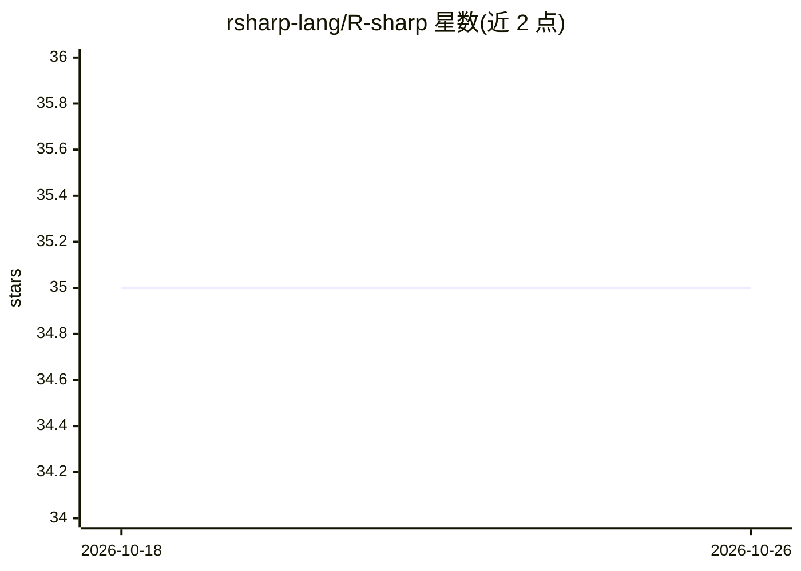

# rsharp-lang/R-sharp

⭐ 35 · Visual Basic .NET · GPL-3.0 · 推送 2026-10-20 · [GitHub](https://github.com/rsharp-lang/R-sharp) · [官网](https://rsharp.net/) · 个人维护

**基于 .NET 的类 R 向量化语言，用于生物信息数据分析**

R# 是实现于 .NET 运行时上的类 R 向量化脚本语言，解释器与 .NET 编译器以 VisualBasic 编写，面向 GCModeller 平台的生物信息学数据分析。系统包含核心运行时、基础库、脚本宿主、shell 与工具包；附带 Python 风格（npy）与 Julia 风格（njl）脚本引擎，可在三种语言间互相导入脚本，并提供 ggplot 风格图形库。README 明确声明项目为进行中、不建议用于生产环境，且需 sciBASIC.NET Framework 运行时。

## 筛选速览

| 维度 | 判定 | 备注 |
|---|---|---|
| AI 角色 | `ai-enhanced` | 去掉 AI 部分产品仍成立 |
| 许可风险 | `viral` | GPL-3.0 |
| 部署形态 | `None` |  |
| 模型依赖 | — | README 未给出锁定关系 |
| 硬件要求 | — | 无带数字的原话,不猜 |
| 安装摩擦 | `medium` | 含编译或系统依赖之一 |
| 成熟度 | `idea` | |

## 能力要点

- 类 R 语法解释器与 .NET 编译器，原生运行于 .NET 运行时
- 多语言互操作：R#/Python 风格/Julia 风格脚本相互导入
- ggplot2 风格的图形语法库
- 读取 R 语言 *.rda/*.rds 数据文件

## 适用场景

- 在 .NET 环境下编写生物信息学数据分析脚本
- 复用 R 语言数据分析习惯进行向量化科学计算
- 在同一运行时内混合使用 R#、Python 与 Julia 风格脚本

## 场景标签

 · 领域:生物信息学/编程语言

## 证据(README 行号)

> L5: R# language is a kind of R liked language implements on .NET environment for the bioinformatics data analysis
> L13: The ``R#`` language is not designed for the general data analysis purpose, but it is specialize designed for my wor

## 星数曲线

2026-10-18 35 → 2026-10-26 35（+0）

---
*卡片 v1 · prompt 1.4 · 生成 2026-10-25 · 置信度 low · 依据 README sha `833c4aaed3a6` · [字段定义](../../DATASET.md)*
