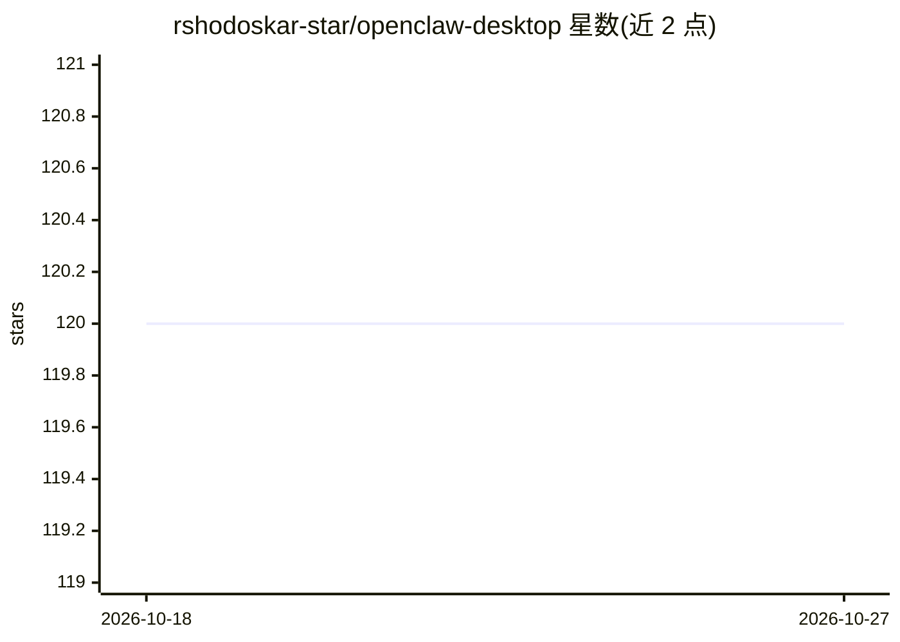

# rshodoskar-star/openclaw-desktop

⭐ 120 · TypeScript · MIT · 推送 2026-06-30 · [GitHub](https://github.com/rshodoskar-star/openclaw-desktop) · [官网](https://github.com/rshodoskar-star/openclaw-desktop/releases) · 个人维护 · 中文 README

**OpenClaw Gateway 的原生桌面客户端，浏览器外的完整管理界面**

基于 Electron + React + TypeScript 构建的 OpenClaw Gateway 前端客户端，本体不运行 AI、不存储数据，所有计算在本地或远程 Gateway 上。功能包括多标签流式聊天、Gemini Live 语音会话、三历法日历与 Cron 提醒（送达 Telegram/Discord/WhatsApp）、成本与分析面板、Agent Hub、9 个内置插件、技能市场（ClawHub 3,286+ 技能）、集成终端与记忆浏览器。支持阿拉伯语(RTL)/英语/西语/中文四种界面语言。需 Windows 10/11，从 Releases 下载安装包或便携版，首次通过 Ed25519 设备认证与 Gateway 配对。

## 筛选速览

| 维度 | 判定 | 备注 |
|---|---|---|
| AI 角色 | `ai-ecosystem` | LLM/agent 周边工具 |
| 许可风险 | `permissive` | MIT |
| 部署形态 | `desktop` | 安装包/桌面程序 |
| 模型依赖 | — | README 未给出锁定关系 |
| 硬件要求 | — | 无带数字的原话,不猜 |
| 安装摩擦 | `low` | 无编译、无系统依赖或容器化 |
| 成熟度 | — | 结构信号不足 |

## 能力要点

- 流式聊天、Artifacts 预览、多标签会话与智能快捷回复
- Gemini Live API 语音对话，Silero VAD 过滤背景噪声
- 三历法日历（公历/伊斯兰/农历）+ Cron 提醒送达 Telegram/Discord/WhatsApp
- 按模型/Agent 维度的成本与分析面板，支持 CSV 导出

## 适用场景

- 在桌面端管理 OpenClaw Gateway 的聊天、Agent 与定时任务
- 可视化编辑 Gateway 配置并保留外部修改
- 语音对话与跨平台提醒接收

## 场景标签

`聊天机器人` `AI 助手` `语音 Agent` · 领域:对话与助手

## 证据(README 行号)

> L147: AEGIS Desktop is a frontend client — it doesn't run AI or store data. Everything lives in your OpenClaw Gateway.
> L3:  The desktop client that turns your OpenClaw Gateway into a full mission control center.

## 星数曲线

2026-10-18 120 → 2026-10-27 120（+0）

---
*卡片 v1 · prompt 1.4 · 生成 2026-10-23 · 置信度 high · 依据 README sha `d8cee9fa2114` · [字段定义](../../DATASET.md)*
