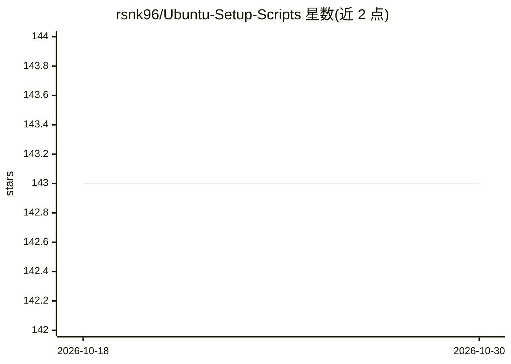

# rsnk96/Ubuntu-Setup-Scripts

⭐ 143 · JavaScript · Apache-2.0 · 推送 2026-10-19 · [GitHub](https://github.com/rsnk96/Ubuntu-Setup-Scripts) · 个人维护

**快速配置 Ubuntu 开发环境的 shell 脚本集**

个人维护的 Ubuntu 初始化脚本集：1-BasicSetUp.sh 配置 Zsh+Zim、aria2、Anaconda、Docker、Nvidia 驱动（检测到时安装）、Neovim+LazyVim 等；2-GenSoftware.sh 安装 VS Code、Cursor、浏览器、gh/glab、xhisper、dltop、VLC、Surfshark 等常用软件；另有 coding-setup 层（CLIProxy、T3 Code、Tailscale）与 add_new_user.sh。已测试 Ubuntu 24.04/26.04 LTS、64 位 Intel/AMD、NVIDIA GPU。附别名、tmux 快捷键说明和示例 Dockerfile。

## 筛选速览

| 维度 | 判定 | 备注 |
|---|---|---|
| AI 角色 | `ai-ecosystem` | LLM/agent 周边工具 |
| 许可风险 | `permissive` | Apache-2.0 |
| 部署形态 | `self-host` | docker 或自建部署 |
| 模型依赖 | — | README 未给出锁定关系 |
| 硬件要求 | — | 无带数字的原话,不猜 |
| 安装摩擦 | `low` | 无编译、无系统依赖或容器化 |
| 成熟度 | — | 结构信号不足 |

## 能力要点

- 两条主脚本按文件名顺序执行完成系统与应用安装
- 检测到 NVIDIA GPU 时自动安装驱动与 Nvidia Container Toolkit
- 预置 jupyter、git、下载加速等 shell 别名
- 提供 add_new_user.sh 为多用户复用 zsh/conda 配置

## 适用场景

- 重装 Ubuntu 后快速恢复数据科学/AI 开发环境
- 批量初始化多用户的开发工作站配置
- 参考示例 Dockerfile 构建自己的环境镜像

## 场景标签

 · 领域:开发环境工具

## 证据(README 行号)

> L18: * `1-BasicSetUp.sh` - Sets up terminal configuration (Zsh + Zim), download accelerator (aria2), Anaconda Python, sh
> L19: * `2-GenSoftware.sh` - Installs general purpose software including VS Code, Cursor IDE, browsers (Brave, Chrome), G

## 星数曲线

2026-10-18 143 → 2026-10-30 143（+0）

---
*卡片 v1 · prompt 1.4 · 生成 2026-10-22 · 置信度 low · 依据 README sha `8adc9bd23e61` · [字段定义](../../DATASET.md)*
