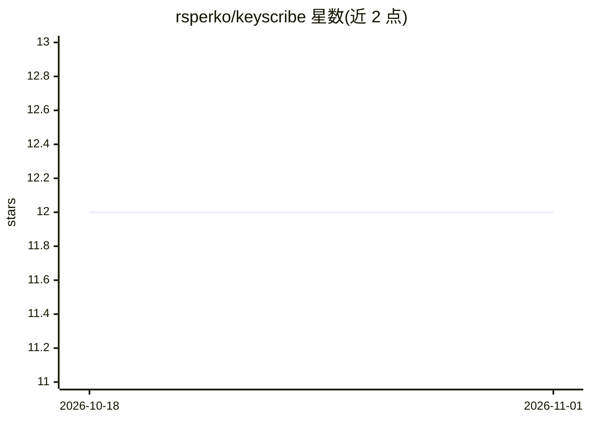

# rsperko/keyscribe

⭐ 12 · Swift · GPL-3.0 · 推送 2026-10-29 · [GitHub](https://github.com/rsperko/keyscribe) · [官网](https://rsperko.github.io/keyscribe/) · 个人维护

**macOS 本地语音听写应用：设备端识别、无遥测**

macOS 菜单栏听写应用：按住 Fn(Globe) 键说话，松开后将文本插入当前焦点输入框。语音识别全部在设备端完成（支持 Parakeet、Whisper、Apple Speech、Qwen3-ASR 家族模型），默认 Plain Dictation 模式不使用 LLM；可选 BYOK 重写模式通过用户配置的 OpenAI 兼容端点润色文本，API key 存于 Keychain，支持本地/无鉴权端点。支持口述编辑命令、按触发键/应用/窗口路由的多模式管线、剪贴板令牌化与尽力脱敏。要求 macOS 15+ Apple silicon，当前为 pre-1.0 预发布版。GPLv3 许可。

## 筛选速览

| 维度 | 判定 | 备注 |
|---|---|---|
| AI 角色 | `ai-native` | 本体是模型或模型工具 |
| 许可风险 | `viral` | GPL-3.0 |
| 部署形态 | `desktop` | 安装包/桌面程序 |
| 模型依赖 | — | README 未给出锁定关系 |
| 硬件要求 | — | 无带数字的原话,不猜 |
| 安装摩擦 | `low` | 无编译、无系统依赖或容器化 |
| 成熟度 | `idea` | |

## 能力要点

- 设备端 STT，音频不离开本机，无遥测无账号
- 可选 BYOK 重写模式，支持本地/无鉴权 OpenAI 兼容端点
- 口述编辑命令（scratch that、逐字片段、剪贴板插入）无需 LLM
- 按触发键/应用/URL/口述后缀路由的多模式管线

## 适用场景

- 在任意应用中按键说话直接输入文字
- 配置 Email/Markdown 等模式让听写内容自动整理格式
- 隐私敏感场景下完全离线听写，避免云端 STT

## 场景标签

`语音识别` · 领域:感知与多模态

## 证据(README 行号)

> L3: **Local-first voice dictation for macOS. On-device speech, no telemetry, powerful modes when you
> L51: |**On-device speech only**|Audio never leaves your Mac. There is no cloud STT mode.|
> L132: Speech models span the Parakeet, Whisper, Apple Speech, and Qwen3-ASR families, from compact

## 星数曲线

2026-10-18 12 → 2026-11-01 12（+0）

---
*卡片 v1 · prompt 1.4 · 生成 2026-11-01 · 置信度 high · 依据 README sha `6b964685b121` · [字段定义](../../DATASET.md)*
