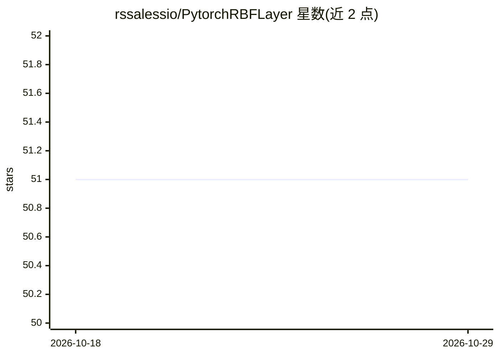

# rssalessio/PytorchRBFLayer

⭐ 51 · Python · MIT · 推送 2025-11-09 · [GitHub](https://github.com/rssalessio/PytorchRBFLayer) · 个人维护

**PyTorch 径向基函数（RBF）层实现，用于函数逼近**

在 PyTorch 中实现径向基函数层 RBFLayer 的库。RBF 由径向核函数、核数量与中心、正形状参数、范数和权重 5 个元素定义，可用于函数逼近，并可与其他 PyTorch 层组合使用。参数既可学习也可设为固定值。要求 Python 3.5 以上与 PyTorch，通过 from rbf_layer import RBFLayer 导入使用，examples/ 文件夹提供多分类示例。MIT 许可，作者为 KTH 博士生。

## 筛选速览

| 维度 | 判定 | 备注 |
|---|---|---|
| AI 角色 | `ai-native` | 本体是模型或模型工具 |
| 许可风险 | `permissive` | MIT |
| 部署形态 | `None` |  |
| 模型依赖 | — | README 未给出锁定关系 |
| 硬件要求 | — | 无带数字的原话,不猜 |
| 安装摩擦 | `low` | 无编译、无系统依赖或容器化 |
| 成熟度 | — | 结构信号不足 |

## 能力要点

- 实现 RBF 层，可与其它 PyTorch 层组合
- 支持自定义径向函数、范数与核数量
- 参数可学习或固定为默认值
- 附带多分类示例代码

## 适用场景

- 在 PyTorch 网络中加入 RBF 层做函数逼近
- 构建或实验径向基函数网络
- 参考示例学习 RBF 层的多分类用法

## 场景标签

 · 领域:深度学习/神经网络库

## 证据(README 行号)

> L2: Pytorch RBF Layer implements a radial basis function layer in Pytorch.
> L4: Radial Basis networks can be used to approximate functions, and can be combined together with other PyTorch layers.

## 星数曲线

2026-10-18 51 → 2026-10-29 51（+0）

---
*卡片 v1 · prompt 1.4 · 生成 2026-10-24 · 置信度 high · 依据 README sha `125d18057801` · [字段定义](../../DATASET.md)*
