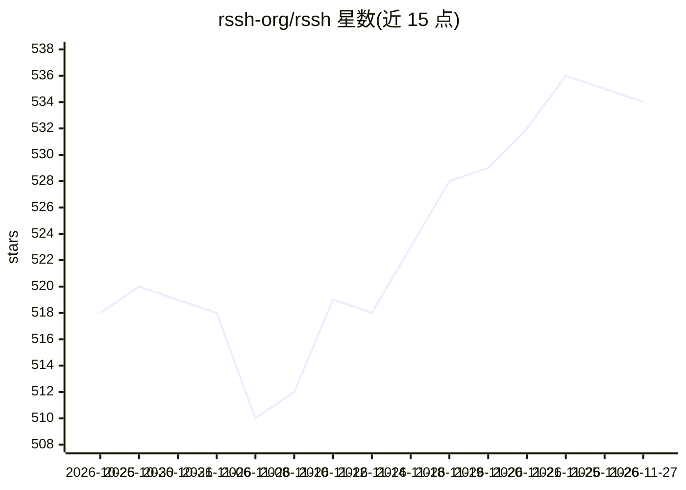

# rssh-org/rssh

⭐ 534 · Rust · MIT · 推送 2026-11-26 · [GitHub](https://github.com/rssh-org/rssh) · [官网](https://rssh.ofcoder.com/) · 组织维护 · 中文 README

**多平台 SSH 客户端：AI 读终端提议命令、块式输出、动态发现容器**

基于 Rust/Tauri 的跨平台 SSH 客户端，覆盖 macOS/Windows/Linux/Android/iOS/HarmonyOS 及 JetBrains 插件，共享同一数据存储。核心功能包括 SSH/Telnet/串口连接、SFTP、端口转发、会话录制、颜色标记命令块（本地渲染）、Docker/K8s 容器动态发现。AI 部分通过读取终端输入输出提议命令，用户批准后执行，服务器端无需安装任何组件；并经 MCP 让本地 agent（如 Codex、Claude Code）复用已连接的终端会话。密钥存于系统 keychain，连接配置加密同步至用户自有 GitHub 仓库。

## 筛选速览

| 维度 | 判定 | 备注 |
|---|---|---|
| AI 角色 | `ai-enhanced` | 去掉 AI 部分产品仍成立 |
| 许可风险 | `permissive` | MIT |
| 部署形态 | `desktop` | 安装包/桌面程序 |
| 模型依赖 | — | README 未给出锁定关系 |
| 硬件要求 | — | 无带数字的原话,不猜 |
| 安装摩擦 | `low` | 无编译、无系统依赖或容器化 |
| 成熟度 | — | 结构信号不足 |

## 能力要点

- AI 读取终端输入/输出并提议命令，执行前需用户批准
- MCP 接口使 Codex/Claude Code 等本地 agent 可使用已连接的 RSSH 终端
- Docker/K8s 容器与 Pod 动态发现，打开临时 exec 终端
- 桌面、移动、JetBrains、CLI 共享数据存储，密钥留在本地 OS keychain

## 适用场景

- 运维终端里让 AI 读取报错并提议排查命令
- 在手机/平板上通过虚拟键栏管理服务器连接
- 本地开发环境动态发现并进入 Docker 容器终端
- 在 JetBrains IDE 内嵌完整 SSH 客户端窗口

## 场景标签

 · 领域:开发运维工具/终端

## 证据(README 行号)

> L5: **A genuinely different SSH client — built to fix the pain points everyone else ignored.**
> L9: > RSSH goes further: commands become navigable blocks, containers are discovered live, and the AI reads the terminal
> L27: ### 🤖 AI triage

## 星数曲线

2026-10-25 518 → 2026-11-27 534（+16）

---
*卡片 v1 · prompt 1.4 · 生成 2026-11-25 · 置信度 high · 依据 README sha `a3e32fedb4e8` · [字段定义](../../DATASET.md)*
