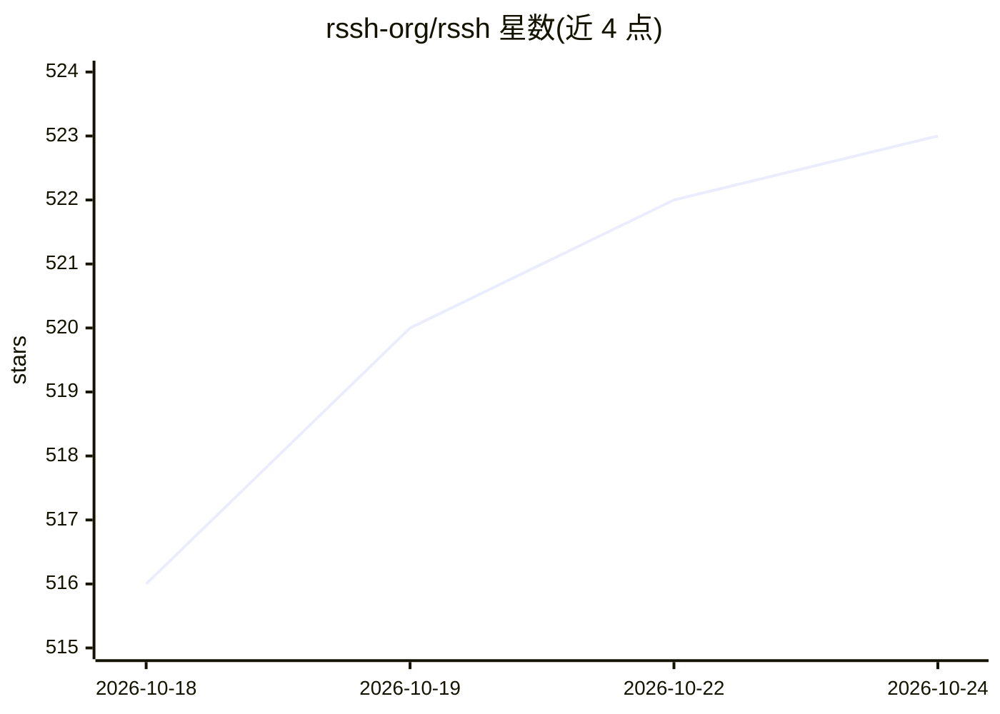

# rssh-org/rssh

⭐ 523 · Rust · MIT · 推送 2026-10-23 · [GitHub](https://github.com/rssh-org/rssh) · [官网](https://rssh.ofcoder.com/) · 组织维护 · 中文 README

**跨平台 SSH 客户端：AI 读取终端并提议命令，覆盖桌面/移动/IDE**

基于 Rust/Tauri 的多平台 SSH/Telnet/串口客户端，提供 macOS、Windows、Linux、Android、iOS 版本及 JetBrains 插件与 CLI，共享同一数据目录。核心机制包括：AI 读取终端输入输出并提议命令（用户批准后执行）、彩色命令块本地渲染、通过本地 CLI 上下文动态发现 Docker/K8S 容器与 Pod、密钥存于系统钥匙串且配置加密同步到用户自有 GitHub 仓库或 WebDAV。另支持 SFTP、端口转发、会话录制（asciicast v2）、多会话广播等。

## 筛选速览

| 维度 | 判定 | 备注 |
|---|---|---|
| AI 角色 | `ai-enhanced` | 去掉 AI 部分产品仍成立 |
| 许可风险 | `permissive` | MIT |
| 部署形态 | `desktop` | 安装包/桌面程序 |
| 模型依赖 | — | README 未给出锁定关系 |
| 硬件要求 | — | 无带数字的原话,不猜 |
| 安装摩擦 | `low` | 无编译、无系统依赖或容器化 |
| 成熟度 | — | 结构信号不足 |

## 能力要点

- AI 读取终端输入输出并提议命令，执行前需用户批准
- 通过本地 CLI 上下文动态发现 Docker/K8S 容器与 Pod 并打开 exec 终端
- SSH/Telnet/串口/SFTP/端口转发/会话录制（asciicast v2）多协议支持
- 密钥存 OS 钥匙串、ChaCha20-Poly1305 加密同步到自有 GitHub 仓库或 WebDAV

## 适用场景

- 在本地开发/测试环境直接连到动态变化的容器与 Pod，而非记静态 IP
- 让 AI 读取终端现场并给出命令建议，人工批准后执行
- 在桌面、手机与 JetBrains IDE 间共享主机、密钥与配置

## 场景标签

`AI 助手` · 领域:对话与助手

## 证据(README 行号)

> L19:  RSSH — ask a question, the AI proposes commands, you approve before they run
> L28: Not another chat box. Nothing to install on your servers — it works like a human operator, reading the terminal's i
> L49: - **SSH** -- password, private key, SSH agent/Pageant, keyboard-interactive, jump host (ProxyJump)

## 星数曲线

2026-10-18 516 → 2026-10-24 523（+7）

---
*卡片 v1 · prompt 1.4 · 生成 2026-10-21 · 置信度 high · 依据 README sha `74ce5985c760` · [字段定义](../../DATASET.md)*
