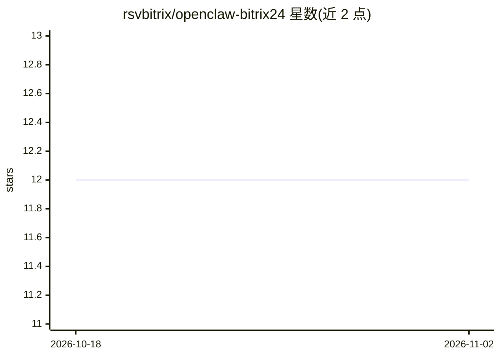

# rsvbitrix/openclaw-bitrix24

⭐ 12 · TypeScript · 推送 2026-03-08 · [GitHub](https://github.com/rsvbitrix/openclaw-bitrix24) · 组织维护

**把 OpenClaw AI 代理接入 Bitrix24 的渠道插件与技能**

OpenClaw 的 Bitrix24 渠道插件与配套技能：在 Bitrix24 门户自动注册聊天机器人，用户通过 Bitrix24 Messenger 与代理对话；代理可经技能调用 Bitrix24 REST API，操作 CRM、任务、日历、云盘、聊天与用户信息。支持 webhook 与 OAuth 两种认证、多账户配置，内置 2 req/s 令牌桶限流、Markdown/BB-code 转换与长消息分块。开发需 Node.js >= 18，需公网可访问的 HTTPS 端点接收事件。

## 筛选速览

| 维度 | 判定 | 备注 |
|---|---|---|
| AI 角色 | `ai-ecosystem` | LLM/agent 周边工具 |
| 许可风险 | `none` | — |
| 部署形态 | `library` | 以包/库形式分发 |
| 模型依赖 | — | README 未给出锁定关系 |
| 硬件要求 | — | 无带数字的原话,不猜 |
| 安装摩擦 | `low` | 无编译、无系统依赖或容器化 |
| 成熟度 | — | 结构信号不足 |

## 能力要点

- 启动时自动在 Bitrix24 门户注册聊天机器人
- 技能覆盖 CRM/任务/日历/云盘/聊天/用户六大模块
- webhook 与 OAuth 双认证，支持多门户账户
- 限流、Markdown↔BB-code 转换、长消息自动分块

## 适用场景

- 在 Bitrix24 Messenger 中直接与我的 AI 代理对话
- 让代理代管 CRM 交易、联系人与跟进活动
- 通过对话创建/分派任务、管理日历与云盘文件

## 场景标签

`聊天机器人` · 领域:对话与助手

## 证据(README 行号)

> L3: Channel plugin and skill that connect your OpenClaw AI agent to Bitrix24. Users chat with the agent through Bitrix24
> L146: 4. Message is forwarded to the OpenClaw agent for processing

## 星数曲线

2026-10-18 12 → 2026-11-02 12（+0）

---
*卡片 v1 · prompt 1.4 · 生成 2026-11-01 · 置信度 high · 依据 README sha `5cd3fd0aee4d` · [字段定义](../../DATASET.md)*
