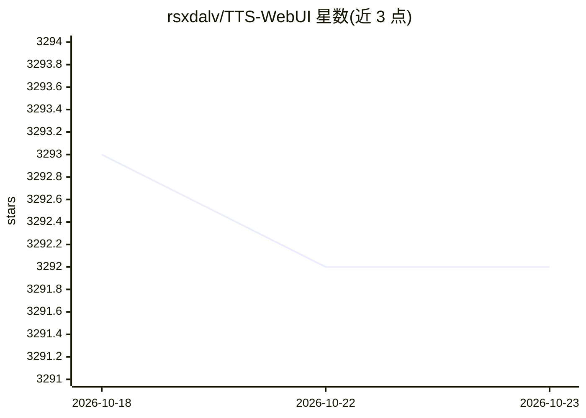

# rsxdalv/TTS-WebUI

⭐ 3,292 · TypeScript · MIT · 推送 2026-09-07 · [GitHub](https://github.com/rsxdalv/TTS-WebUI) · [官网](http://TTSWebUI.com/) · 个人维护

**聚合数十种 TTS/音频生成模型的本地 WebUI**

基于 Gradio + React 的 Web 界面，集成 Bark、Tortoise、XTTSv2、CosyVoice、GPT-SoVITS、Kimi Audio、MusicGen、RVC、Demucs 等文本转语音、音频/音乐生成与音频转换模型；带星标模型作为扩展安装，扩展本质是 pip 安装的 Python 包。提供 Windows 安装器（Ignition/winget）、源码安装与 Docker 镜像，基础安装约 10.7 GB，每个模型另需 2-8 GB。内置 OpenAI 兼容 API 端点，可对接 Silly Tavern、OpenWebUI 等客户端。代码 MIT，但依赖与模型权重各有许可，部分依赖为非宽松许可。

## 筛选速览

| 维度 | 判定 | 备注 |
|---|---|---|
| AI 角色 | `ai-native` | 本体是模型或模型工具 |
| 许可风险 | `permissive` | MIT |
| 部署形态 | `desktop` | 安装包/桌面程序 |
| 模型依赖 | — | README 未给出锁定关系 |
| 硬件要求 | — | 无带数字的原话,不猜 |
| 安装摩擦 | `low` | 无编译、无系统依赖或容器化 |
| 成熟度 | — | 结构信号不足 |

## 能力要点

- 内置 40+ 种 TTS/音频生成/转换模型，未默认安装的以扩展形式提供
- 暴露 OpenAI 兼容 API 端点（/v1/audio/speech），可接入 Silly Tavern、OpenWebUI、oobabooga WebUI
- 支持 Windows 安装器、winget、源码与 Docker 四种安装方式
- 扩展系统基于 pip 包，支持内置扩展管理器与 JSON 外部扩展安装

## 适用场景

- 本地运行多种 TTS 模型生成语音，不需要逐个部署各模型项目
- 为 Silly Tavern / OpenWebUI 等对话前端提供本地 OpenAI 兼容 TTS API
- 在一个界面里做语音转换（RVC）、人声分离（Demucs）与音乐生成（MusicGen）

## 场景标签

`语音合成` · 领域:内容生成

## 证据(README 行号)

> L37: ## Supported Models
> L41: |Bark|MusicGen|RVC|
> L204:  Default provider endpoint: `http://localhost:7778/v1/audio/speech`

## 星数曲线

2026-10-18 3,293 → 2026-10-23 3,292（-1）

---
*卡片 v1 · prompt 1.4 · 生成 2026-10-20 · 置信度 mid · 依据 README sha `0df7169d92bc` · [字段定义](../../DATASET.md)*
