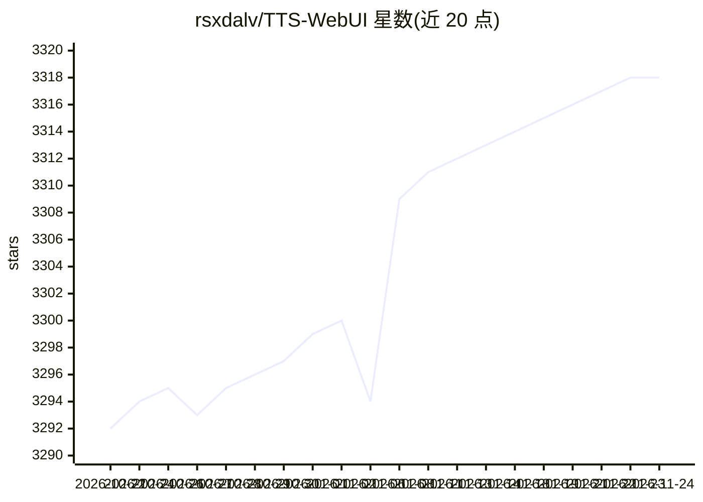

# rsxdalv/TTS-WebUI

⭐ 3,317 · Go · MIT · 推送 2026-11-23 · [GitHub](https://github.com/rsxdalv/TTS-WebUI) · [官网](http://TTSWebUI.com/) · 个人维护

**集成多款 TTS 与音乐生成模型的 WebUI，供用户生成语音和音频**

基于 Gradio 后端与 React 前端的统一 Web 界面，聚合 20 余个文本转语音模型（Bark、XTTSv2、CosyVoice、GPT-SoVITS、Piper 等）与音频/音乐生成模型（MusicGen、Stable Audio、ACE-Step 等）及音频工具（RVC、Demucs、Whisper）。多数模型以 pip 扩展形式按需安装，可从 WebUI 内部管理。提供 Windows 安装器（约 10.7 GB 起步）、Docker 镜像与手动安装路径；内置 OpenAI 兼容 TTS API，可接入 SillyTavern、OpenWebUI 等客户端。依赖项之间存在已知兼容性警告，作者声明属预期现象。

## 筛选速览

| 维度 | 判定 | 备注 |
|---|---|---|
| AI 角色 | `ai-native` | 本体是模型或模型工具 |
| 许可风险 | `permissive` | MIT |
| 部署形态 | `desktop` | 安装包/桌面程序 |
| 模型依赖 | — | README 未给出锁定关系 |
| 硬件要求 | — | 无带数字的原话,不猜 |
| 安装摩擦 | `low` | 无编译、无系统依赖或容器化 |
| 成熟度 | — | 结构信号不足 |

## 能力要点

- 单界面集成 20+ TTS 模型与音乐/音频生成模型
- 扩展以 pip 包形式安装，支持 WebUI 内一键安装与扩展目录
- 内置 OpenAI 兼容 API（/v1/audio/speech），可对接 SillyTavern、OpenWebUI
- 提供 winget 安装器、Docker 镜像（ghcr.io）与手动安装三条路径

## 适用场景

- 在一个界面里试用和对比多种开源 TTS 模型的语音效果
- 用 MusicGen/Stable Audio 生成音乐和音频
- 通过 OpenAI 兼容接口给 SillyTavern、OpenWebUI 配置本地 TTS
- 用 RVC 做声音转换并用 Demucs 分离音轨

## 场景标签

`语音合成` `语音识别` · 领域:内容生成

## 证据(README 行号)

> L37: ## Supported Models
> L88: * Run start_tts_webui.bat or start_tts_webui.sh to start the server. It will ask you to select the GPU/Chip you are
> L215: Using the instructions above, you can install an OpenAI compatible API, and use it with Silly Tavern or other Open

## 星数曲线

2026-10-22 3,292 → 2026-11-24 3,318（+26）

---
*卡片 v1 · prompt 1.4 · 生成 2026-11-24 · 置信度 high · 依据 README sha `12d74500c3b1` · [字段定义](../../DATASET.md)*
