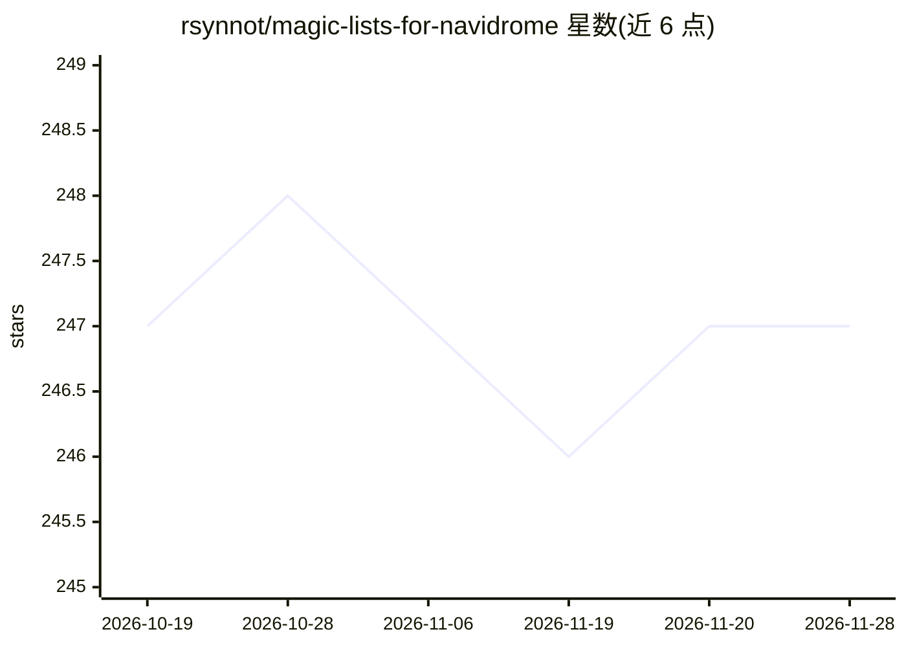

# rsynnot/magic-lists-for-navidrome

⭐ 247 · Python · 推送 2026-11-23 · [GitHub](https://github.com/rsynnot/magic-lists-for-navidrome) · 个人维护

**为自托管 Navidrome 音乐库生成 AI 策展播放列表的工具**

面向 Navidrome 自托管用户的播放列表生成器：提供 This Is (Artist)、Genre Mix、Re-Discover Weekly 三类播放列表，支持日/周/月自动刷新与多音乐库配置，通过 Navidrome API 读写播放列表。AI 配置为可选项，支持 Ollama 本地模型、OpenRouter、Google AI、Groq 等云端通道；未配置 AI 时回退到基于播放次数与元数据排序的生成方式。安装方式为 Docker Compose、独立 Docker 容器或 Python 直接运行。

## 筛选速览

| 维度 | 判定 | 备注 |
|---|---|---|
| AI 角色 | `ai-native` | 本体是模型或模型工具 |
| 许可风险 | `none` | — |
| 部署形态 | `self-host` | docker 或自建部署 |
| 模型依赖 | local-ok | 支持本地模型 |
| 硬件要求 | — | 无带数字的原话,不猜 |
| 安装摩擦 | `low` | 无编译、无系统依赖或容器化 |
| 成熟度 | — | 结构信号不足 |

## 能力要点

- 三类播放列表生成：This Is (Artist)、Genre Mix、Re-Discover Weekly
- 可选多 AI 通道：Ollama 本地模型、OpenRouter、Google AI、Groq
- 无 AI 配置时回退到播放次数与元数据排序生成
- 启动时系统自检页面验证配置与 Navidrome 连接

## 适用场景

- 为自托管音乐库生成类似流媒体服务的策展播放列表
- 用本地 Ollama 模型离线生成播放列表
- 让长期未播放的曲目定期轮换回推荐列表

## 场景标签

 · 领域:音乐/媒体工具

## 证据(README 行号)

> L3: **AI-assisted playlists for your own music library.**
> L9: - 🎸 **Genre Mix** — Creates curated playlists from your complete genre collections, using AI to craft the perfect mi
> L228: 1. **Fallback-only** (Free) - Uses play count and metadata sorting

## 星数曲线

2026-10-19 247 → 2026-11-28 247（+0）

---
*卡片 v1 · prompt 1.4 · 生成 2026-11-25 · 置信度 mid · 依据 README sha `102aa98aafe0` · [字段定义](../../DATASET.md)*
