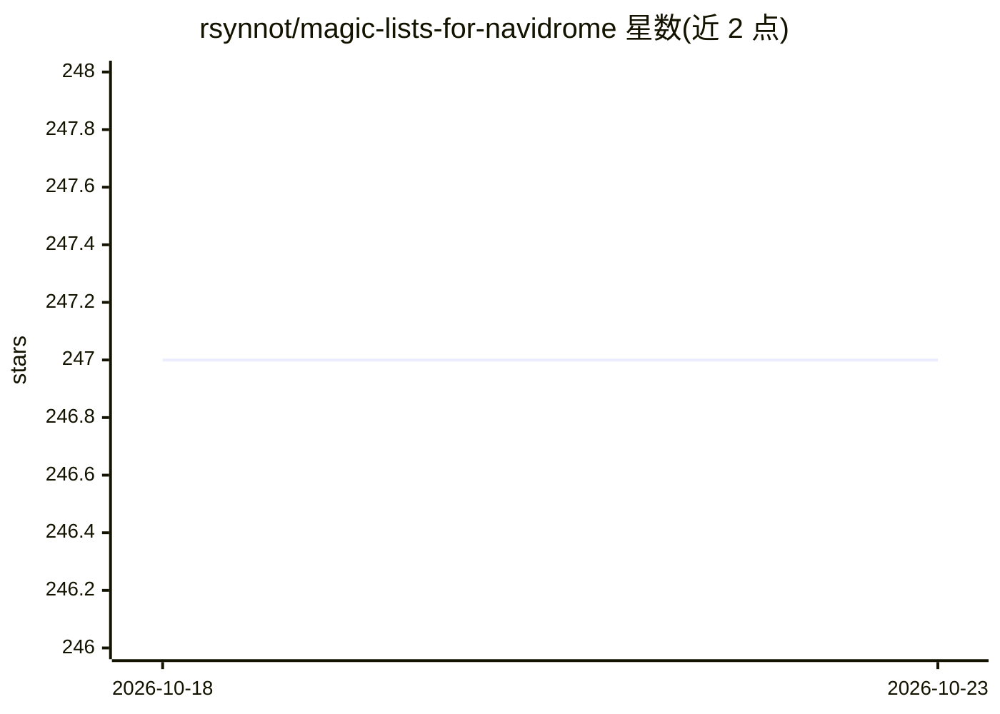

# rsynnot/magic-lists-for-navidrome

⭐ 247 · Python · 推送 2025-11-02 · [GitHub](https://github.com/rsynnot/magic-lists-for-navidrome) · 个人维护

**自建 Navidrome 音乐库的 AI 歌单生成器**

面向 Navidrome 自托管音乐服务用户的歌单工具：通过 Navidrome API 读取音乐库，生成「This Is Artist」「Genre Mix」「Re-Discover」等歌单类型，支持每日/每周/每月自动刷新与多音乐库。AI 为可选配置：不配置时回退为基于播放次数与元数据排序；配置后可接 Ollama 本地模型或 OpenRouter、Google AI、Groq 云服务。提供 Docker Compose、独立容器与 Python 源码三种运行方式，内置启动时系统检查页。作者声明项目处于早期阶段。

## 筛选速览

| 维度 | 判定 | 备注 |
|---|---|---|
| AI 角色 | `ai-native` | 本体是模型或模型工具 |
| 许可风险 | `none` | — |
| 部署形态 | `self-host` | docker 或自建部署 |
| 模型依赖 | local-ok | 支持本地模型 |
| 硬件要求 | — | 无带数字的原话,不猜 |
| 安装摩擦 | `low` | 无编译、无系统依赖或容器化 |
| 成熟度 | `idea` | |

## 能力要点

- This Is Artist / Genre Mix / Re-Discover 三类 AI 歌单生成
- AI 可选：支持 Ollama 本地模型或 OpenRouter / Google AI / Groq，未配置时回退播放次数排序
- 每日/每周/每月自动刷新与多 Navidrome 音乐库支持
- Docker Compose / 独立容器 / Python 源码三种安装方式

## 适用场景

- 给自己的 Navidrome 音乐库生成类似流媒体服务的智能歌单
- 定期自动刷新歌单让收藏保持更新
- 用本地 Ollama 模型离线生成歌单，不向云服务传数据

## 场景标签

`推荐系统` · 领域:学习与行业

## 证据(README 行号)

> L8: - 🎵 **This Is (Artist)** — Builds a definitive playlist for any artist in your library, combining hits, deep cuts, a
> L162: - **AI Provider**: Checks if AI features are configured (OpenRouter, Groq, Google AI, or Ollama)

## 星数曲线

2026-10-18 247 → 2026-10-23 247（+0）

---
*卡片 v1 · prompt 1.4 · 生成 2026-10-22 · 置信度 mid · 依据 README sha `263ad0852dea` · [字段定义](../../DATASET.md)*
