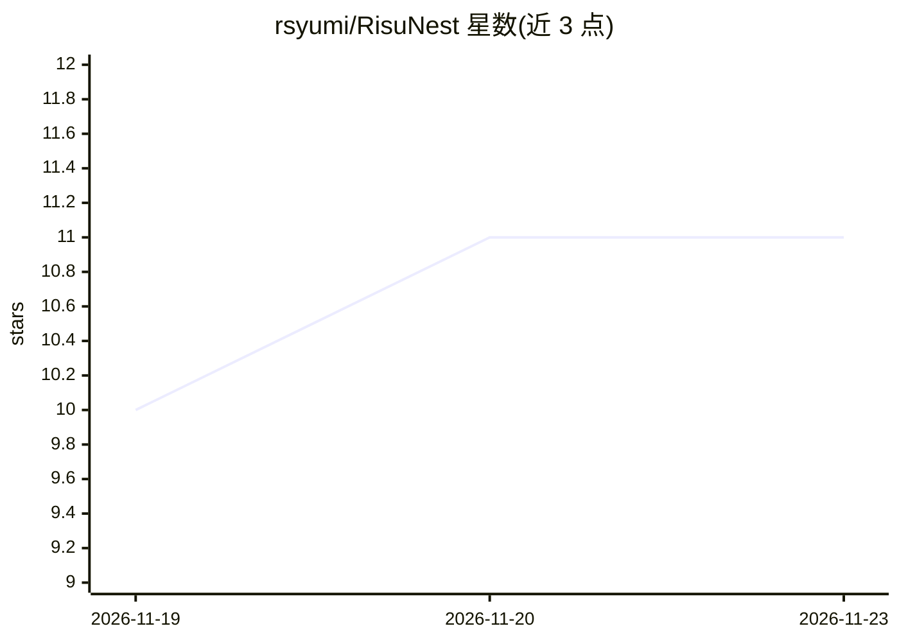

# rsyumi/RisuNest

⭐ 11 · TypeScript · GPL-3.0 · 推送 2026-11-17 · [GitHub](https://github.com/rsyumi/RisuNest) · 组织维护

**面向桌面与移动端的本地 AI 角色扮演聊天应用**

从 RisuAI 分叉的 AI 聊天应用，支持 Windows、macOS、Linux、Android 和 iOS。用户可连接不同 AI 提供商进行对话，管理角色与聊天记录，使用主题和插件。基于 Tauri 2、Svelte 5 与 Rust 构建，本地存储角色/聊天/媒体，支持通过 RisuNest Sync 独立 Rust 守护进程多设备同步，以及 WebDAV/S3/Google Drive 云备份。不兼容上游 Plugin API v2/2.1，仅支持 v3 插件。

## 筛选速览

| 维度 | 判定 | 备注 |
|---|---|---|
| AI 角色 | `ai-native` | 本体是模型或模型工具 |
| 许可风险 | `viral` | GPL-3.0 |
| 部署形态 | `library` | 以包/库形式分发 |
| 模型依赖 | — | README 未给出锁定关系 |
| 硬件要求 | — | 无带数字的原话,不猜 |
| 安装摩擦 | `low` | 无编译、无系统依赖或容器化 |
| 成熟度 | — | 结构信号不足 |

## 能力要点

- 五大平台原生安装包（EXE/DMG/DEB/AppImage/APK/IPA）
- 本地存储角色、聊天与媒体，支持多设备 Sync 同步服务器
- lorebook、regex 脚本、Lua 脚本与 Plugin API v3 扩展机制
- WebDAV/S3/Google Drive 云备份与恢复

## 适用场景

- 在桌面和手机上与多个 AI 提供商进行角色扮演对话
- 从 RisuAI 导入备份迁移到 RisuNest
- 多设备间同步角色与聊天库

## 场景标签

`聊天机器人` · 领域:对话与助手

## 证据(README 行号)

> L19: RisuNest is an AI chat application forked from RisuAI, available for Windows, macOS, Linux, Android, and iOS. Chat 
> L65: - **Desktop and Mobile:** Use the app on Windows, macOS, Linux, Android, and iOS.

## 星数曲线

2026-11-19 10 → 2026-11-23 11（+1）

---
*卡片 v1 · prompt 1.4 · 生成 2026-11-19 · 置信度 mid · 依据 README sha `2db335943733` · [字段定义](../../DATASET.md)*
