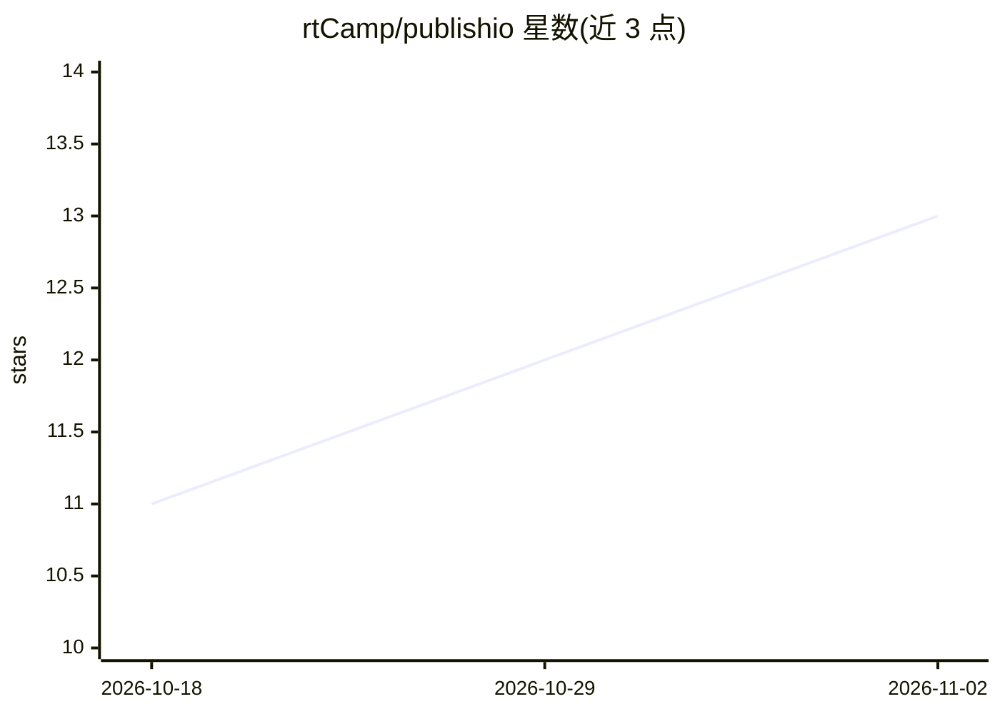

# rtCamp/publishio

⭐ 13 · PHP · GPL-2.0 · 推送 2026-10-30 · [GitHub](https://github.com/rtCamp/publishio) · [官网](https://rtcamp.com) · 组织维护

**WordPress 自托管 MCP 服务器：让 ChatGPT/Claude 按站点既有样式发布页面**

以 WordPress 插件形式实现的原生 MCP 服务器，把 ChatGPT、Claude 等 MCP 客户端连接到自托管 WordPress 站点。AI 依据站点自身注册的区块模式（block patterns）拼装落地页与结构化版块，散文内容使用主题样式的原生区块；通过 OAuth 认证，无第三方中转服务。提供模式自动发现、逐段聊天内审批、SEO 元数据（兼容 Yoast）与连接状态诊断。要求 WordPress 6.9+、PHP 8.2+、伪静态固定链接，仅支持基于区块/FSE 的主题，不支持 Elementor 等页面构建器；Cursor、Windsurf 等客户端因缺少 CIMD 支持暂无法连接。

## 筛选速览

| 维度 | 判定 | 备注 |
|---|---|---|
| AI 角色 | `ai-ecosystem` | LLM/agent 周边工具 |
| 许可风险 | `viral` | GPL-2.0 |
| 部署形态 | `None` |  |
| 模型依赖 | locked-api |  |
| 硬件要求 | — | 无带数字的原话,不猜 |
| 安装摩擦 | `low` | 无编译、无系统依赖或容器化 |
| 成熟度 | — | 结构信号不足 |

## 能力要点

- 在 WordPress 站点上暴露自托管 MCP 端点，OAuth 认证直连 AI 客户端
- 自动发现主题/插件/核心注册的全部区块模式，AI 按元数据选择并填充内容
- 每段内容在聊天中预览审批后才加入草稿，AI 不能直接发布
- 兼容任何区块/FSE 主题，支持自定义文章类型

## 适用场景

- 编辑团队用 ChatGPT 或 Claude 对话式产出符合品牌设计系统的落地页与文章
- 让 AI 沿用设计师已批准的区块模式建站，避免破坏版式
- 在自有 WordPress 站点内自托管 MCP 端点，数据不经第三方服务

## 场景标签

`AI 写作` · 领域:内容生成

## 证据(README 行号)

> L11: Publishio is not another AI writer, and it is not a page builder that reinvents your layout. It is a native **MCP s
> L25: - **Connect ChatGPT, Claude, and other MCP clients:** A standard MCP server for WordPress that works with ChatGPT, 

## 星数曲线

2026-10-18 11 → 2026-11-02 13（+2）

---
*卡片 v1 · prompt 1.4 · 生成 2026-11-01 · 置信度 high · 依据 README sha `712d63560486` · [字段定义](../../DATASET.md)*
